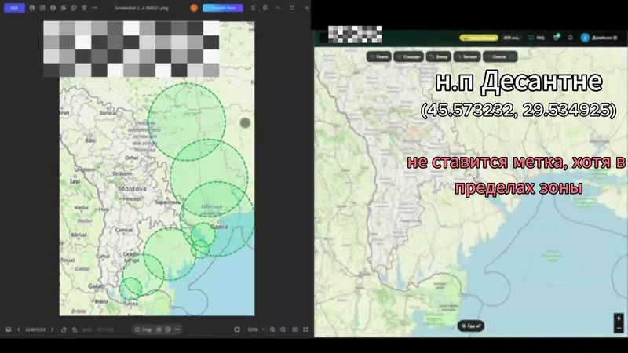

# Geospatial Boundary Violation — Commercial Project (Anonymized)

> ⚠️ **NDA Notice:** Project name, URLs, city names and sensitive data are 
> anonymized. Testing approach and artifacts reflect my actual contribution.

## Project Info
- **Project type:** Map-based mobile & web application with store markers (pins)
- **My role:** Manual QA / Beta Tester (exploratory testing, part-time, parallel with education)
- **Period:** 14.09.2026
- **Tools:** DevTools, screen recording, Testiny

## Task / Context
Testing the **geospatial boundaries** of the supported "green zone". The application 
is designed to restrict marker placement only to a specific, predefined service area.
 
My task was to verify if the system correctly prevents users from placing markers 
outside this zone, specifically testing locations on the administrative borders 
(e.g., settlements that are part of the region but located outside the main city limits).

## Test Cases & Results

### TC-01: Attempting to place a marker in a border settlement
| Field | Value |
|-------|-------|
| **Steps** | 1. Open the map and ensure the user has available marker slots. 2. Move the map to a settlement inside the region but outside the primary "green zone". 3. Attempt to place a marker. |
| **Expected** | The system blocks marker creation for any location outside the designated green zone, regardless of administrative borders. |
| **Actual** | The map correctly identifies the settlement as part of the region (displayed normally), but allows the user to place a marker **outside the visible green zone boundary**. |
| **Result** | ❌ **Failed** — defect found (see BUG-001) |
| **Comments** | The user can place markers in areas that are not part of the intended service area (partially overlapping the green zone but extending beyond it). |
| **Attachments** |  |

## Summary of Results
| Test Case | Result |
|-----------|--------|
| TC-01 | ❌ Failed (bug found) |

**Not passed:** 1 of 1 — due to the found defect BUG-001.

## Defect Log

### BUG-001: Markers can be placed outside the designated green zone (Geospatial logic flaw)
| Field | Value |
|-------|-------|
| **Severity** | Major |
| **Priority** | High |
| **Status** | Open / Reported |
| **Environment** | Web / Mobile app |

**Steps to reproduce:**
1. Open the app and go to the map.
2. Navigate to a border settlement (e.g., a nearby town that is administratively part of the region).
3. Try to place a marker in the center of this settlement.

**Expected:** The system prevents marker placement because the location is outside the strict "green zone" limits.
**Actual:** The marker is placed successfully, even though it's outside the visual green zone boundary. The system seems to be checking administrative boundaries rather than the actual service area.

**Comments:** 
1. The coordinates overlap with the region, but not the service zone. 
2. **Suggested fix:** The validation logic should check against the actual coordinates (GeoJSON polygon) of the green zone, rather than just checking if the coordinates fall within the broader region.

**Attachments:** 

## Conclusion
This case was a fascinating exercise in **Geospatial Testing** and **Business Logic verification**.

By testing locations on the administrative borders, I discovered that the backend validation was checking the wrong geographic data. Instead of strictly enforcing the visual "green zone", the system relied on broader regional borders. 

This highlighted that as a QA, I need to think about how systems interpret data — "inside the region" does not always mean "inside the service area". Catching this early prevents users from placing invalid markers in areas the business doesn't support.
