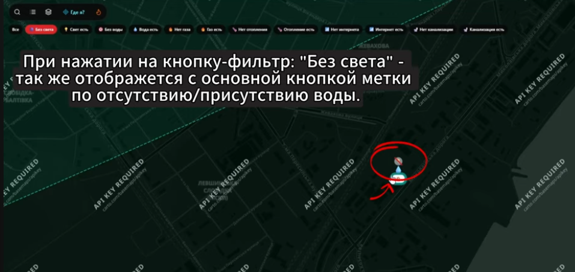
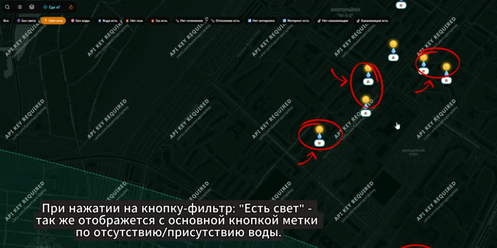
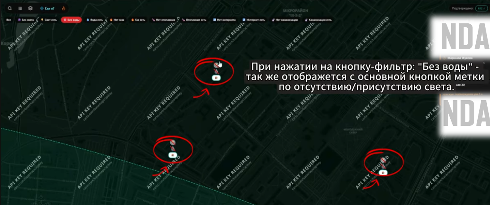
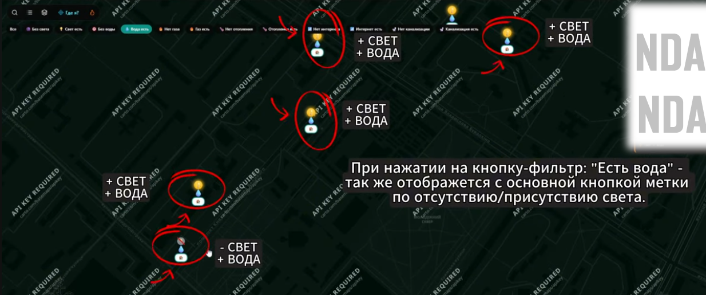

# Map Markers Filtering — Commercial Project (Anonymized)

> ⚠️ **NDA Notice:** Project name, URLs, city names and sensitive data are 
> anonymized. Testing approach and artifacts reflect my actual contribution.

## Project Info
- **Project type:** Map-based mobile & web application with store markers (pins) on an interactive map
- **My role:** Manual QA / Beta Tester (exploratory testing, part-time, parallel with education)
- **Period:** 19.09.2026 – 20.09.2026
- **Tools:** Testiny (Test Management), DevTools, screen recording, screenshots

## Task / Context
Following the marker creation testing, I focused on the **marker filtering logic**. 
The application allows users to filter map markers by utility statuses: 
**"No Power"**, **"Has Power"**, **"No Water"**, and **"Has Water"**.

My task was to verify that the filters correctly isolate and display **only** 
the markers that match the selected criteria, without showing unrelated 
infrastructure data.

**Exploratory session charter:** Investigate the map filter module — verify 
data isolation for each filter, check for overlapping data (e.g., water markers 
appearing under power filters), and test rapid toggling.

## Test Cases & Results

### TC-01: Electricity filter isolation (No Power / Has Power)
| Field | Value |
|-------|-------|
| **Steps** | 1. Open the map. 2. Click the **"No Power"** filter. 3. Check displayed markers. 4. Click the **"Has Power"** filter. 5. Check displayed markers. |
| **Expected** | The filter should display **only** markers related to the selected power status. Markers with water data (unrelated to power) should be hidden. |
| **Actual** | The filter displays the selected power status, but **also includes unrelated markers** (e.g., markers with water availability appearing alongside power markers). |
| **Result** | ❌ **Failed** — defect found (see BUG-001) |
| **Comments** | Filter logic is broken. It does not isolate the requested attribute and mixes different utility statuses together. |
| **Attachments** |   |

### TC-02: Water filter isolation (No Water / Has Water)
| Field | Value |
|-------|-------|
| **Steps** | 1. Open the map. 2. Click the **"No Water"** filter. 3. Check displayed markers. 4. Click the **"Has Water"** filter. |
| **Expected** | The filter should display **only** markers matching the water status criteria. Markers with unrelated attributes (e.g., power) should be hidden. |
| **Actual** | Same issue as TC-01 — the filter shows markers with unrelated attributes (e.g., power markers bleeding into the water filter). |
| **Result** | ❌ **Failed** — defect found (see BUG-001) |
| **Comments** | The developer confirmed the issue: *"В целом то же самое, что и с прошлым тест-кейсом"* (Basically the same as the previous test case). The filtering logic is consistently flawed. |
| **Attachments** |   |

## Summary of Results
| Test Case | Result |
|-----------|--------|
| TC-01 | ❌ Failed (bug found) |
| TC-02 | ❌ Failed (bug found) |

**Not passed:** 2 of 2 — due to the found defect BUG-001.

## Defect Log

### BUG-001: Map filters do not isolate marker statuses (data bleeding)
| Field | Value |
|-------|-------|
| **Severity** | Major |
| **Priority** | High |
| **Status** | Open / Reported |
| **Environment** | Map-based app, mobile & web |

**Steps to reproduce:**
1. Open the app → go to the Map.
2. Ensure the map has markers with different utility statuses (power, water).
3. Apply the **"Has Power"** filter.

**Expected:** Only markers indicating the presence of power are shown. All other markers (e.g., water only) are hidden.
**Actual:** The map displays power markers **and** markers with unrelated statuses (e.g., water availability).

**Comments:** The filter query is not strict. It returns nodes that match the requested attribute but fails to exclude nodes that only have other attributes. Developer confirmed the behavior.

**Resolution:** The developer already fixed it after receiving my bug report

## Conclusion
This case was a great exercise in **finding logic defects in data filtering**. 
At first glance, the UI seemed to work: the buttons highlighted, previous filters 
reset, and there were no visual glitches or duplicates.

However, by carefully checking **what** was actually displayed on the map, I 
discovered that the filters were mixing unrelated data. For example, clicking 
"Has Power" showed not only power markers but also water markers. 

This reinforced a key QA principle: **always verify the actual data, not just the 
UI state**. A filter can look visually correct but still return the wrong dataset.
