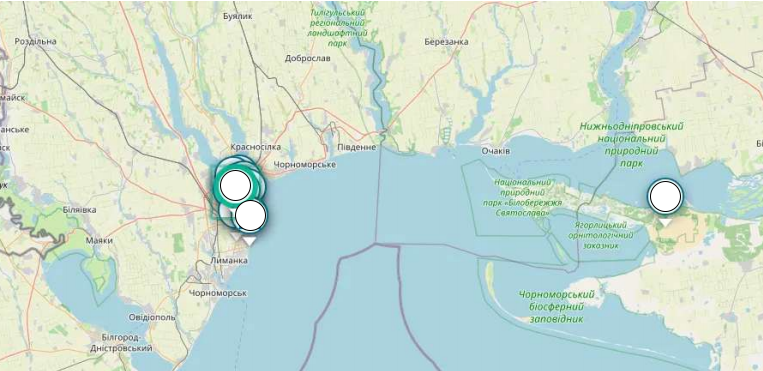

# Map Markers Testing — Commercial Project (Anonymized)

> ⚠️ **NDA Notice:** Project name, URLs, city names and sensitive data are 
> anonymized. Testing approach and artifacts reflect my actual contribution.

## Project Info
- **Project type:** Map-based mobile & web application with store markers (pins) on an interactive map
- **My role:** Manual QA / Beta Tester (exploratory testing, part-time, parallel with education)
- **Period:** 27.08.2026 – 02.09.2026
- **Tools:** DevTools, screen recording, screenshots, manual exploratory sessions

## Task / Context
The application displays an interactive map with store markers (pins). 
Each marker contains a product assortment and status indicators. 
The service was initially designed to work **only within a designated 
city / supported service area** — functionality outside that zone was 
not intended.

My task was to perform **exploratory testing** of the marker functionality 
from a regular user's perspective (beta tester): design test scenarios 
independently, without a ready-made checklist, and document the findings.

**Exploratory session charter:** Investigate the map marker module — 
marker creation, supported service area boundaries, behavior when 
overloading a single point, and completeness of marker display.

## Test Cases & Results

### TC-01: Creating a marker outside the supported service area
| Field | Value |
|-------|-------|
| **Steps** | 1. Open the map. 2. Pan the map outside the designated city / supported service area. 3. Try to create a marker at a point outside the zone. |
| **Expected** | Marker is not created — the app is limited to the supported service area. |
| **Actual** | Marker is successfully created far outside the supported service area. |
| **Result** | ❌ **Failed** — defect found (see BUG-001) |
| **Comments** | Business logic is broken: the service works only within the designated city, but allows placing markers anywhere. |
| **Attachments** |  |

### TC-02: Spamming markers at a single point
| Field | Value |
|-------|-------|
| **Steps** | 1. Open the map. 2. Add several markers to the same point in a row. |
| **Expected** | Duplicates are blocked or grouped. |
| **Actual** | Behavior matches expectations. |
| **Result** | ✅ **Passed** |

### TC-03: Displaying all available markers
| Field | Value |
|-------|-------|
| **Steps** | 1. Open the map. 2. Verify that all available markers are displayed correctly. |
| **Expected** | All markers are visible, nothing disappears. |
| **Actual** | All markers are displayed correctly. |
| **Result** | ✅ **Passed** |

## Summary of Results
| Test Case | Result |
|-----------|--------|
| TC-01 | ❌ Failed (bug found) |
| TC-02 | ✅ Passed |
| TC-03 | ✅ Passed |

**Not passed:** 1 of 3 — due to the found defect BUG-001.

## Defect Log

### BUG-001: Ability to create markers outside the supported service area
| Field | Value |
|-------|-------|
| **Severity** | Major |
| **Priority** | High |
| **Status** | Fixed (zone restricted by developer) |
| **Environment** | Map-based app, mobile & web |

**Steps to reproduce:**
1. Open the app → go to the Map.
2. Pan the map far outside the designated city / supported service area.
3. Create a new marker at that location.

**Expected:** marker creation is blocked outside the supported zone.
**Actual:** the marker is successfully created far outside the supported area.

**Comments:** Business logic is broken — the service is designed to work 
only within a specific supported zone, but the app allows placing markers 
anywhere, including regions the service was never intended to cover.

**Resolution:** The developer restricted marker creation to the supported 
service area. Fix confirmed.

## Conclusion
This case gave me hands-on practice in **exploratory testing** from a 
regular user's perspective (beta tester): I designed test scenarios 
independently, without a ready-made checklist, and checked boundary 
scenarios — the things that are not described in the documentation.

The key finding was a **boundary defect**: the app allowed creating 
markers outside the supported service area, even though the service was 
initially designed for a designated city only. The defect was confirmed 
and fixed by the developer (the zone was restricted).

This case reinforced my understanding that **testing is not only about 
running a checklist, but also about thinking like a user**: "what if I 
do something nobody asked for?" That is exactly how you find what 
default test cases miss.
