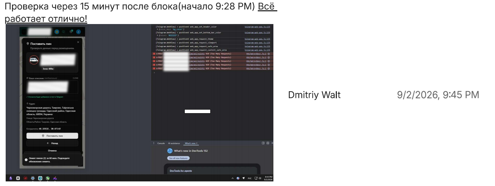
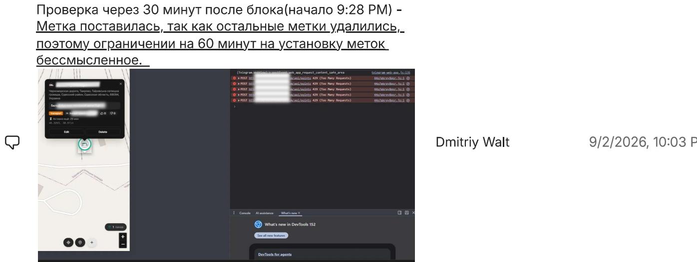
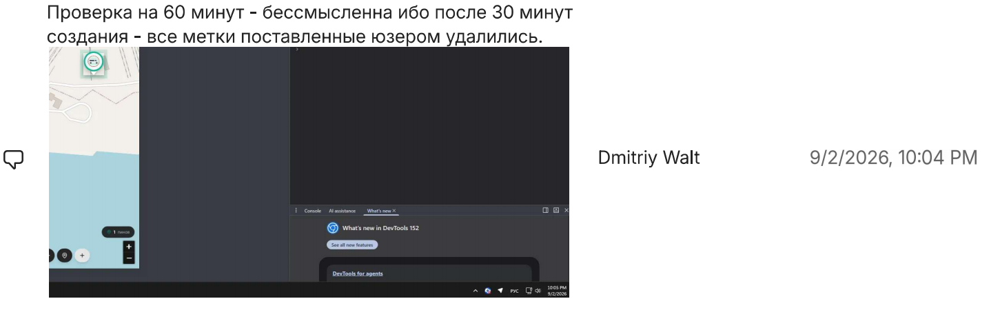

# Marker Cooldown Timer Bug (Boundary Testing) — Commercial Project (Anonymized)

> ⚠️ **NDA Notice:** Project name, URLs, city names and sensitive data are 
> anonymized. Testing approach and artifacts reflect my actual contribution.

## Project Info
- **Project type:** Map-based mobile & web application with store markers (pins) on an interactive map
- **My role:** Manual QA / Beta Tester (exploratory testing, part-time, parallel with education)
- **Period:** 02.09.2026
- **Tools:** Testiny (Test Management), DevTools, screen recording

## Task / Context
Testing the **rate limit cooldown timer**. After adding 2 markers, the user is 
supposed to be blocked for 60 minutes. 

My task was to verify the boundary values of this timer (15 minutes, 30 minutes, 
and 60 minutes) to ensure the cooldown logic works as intended and does not 
negatively affect existing user data.

## Test Cases & Results

### TC-01: Cooldown timer boundary values (15m, 30m, 60m)
| Field | Value |
|-------|-------|
| **Steps** | 1. Add 2 markers (timer starts). 2. Wait **15 minutes** and try to add a marker. 3. Wait **30 minutes** and try to add a marker. 4. Wait **60 minutes** and try to add a marker. |
| **Expected** | The user is blocked at 15m and 30m. Exactly at the 60-minute mark, the limit resets, and the user can add new markers, while the old ones remain on the map. |
| **Actual** | **15m & 30m:** Blocked correctly. **60m:** The user's previously placed markers are deleted, the limit resets, and new markers can be added. |
| **Result** | ❌ **Failed** — defect found (see BUG-001) |
| **Comments** | The timer behavior breaks the core business logic. It uses a "fixed window" instead of a "sliding window", and deletes existing data upon reset. |
| **Attachments** |      |

## Summary of Results
| Test Case | Result |
|-----------|--------|
| TC-01 | ❌ Failed (bug found) |

**Not passed:** 1 of 1 — due to the found defect BUG-001.

## Defect Log

### BUG-001: Rate limit timer resets incorrectly, deleting existing markers
| Field | Value |
|-------|-------|
| **Severity** | Major |
| **Priority** | High |
| **Status** | Open / Reported |
| **Environment** | Web & Mobile |

**Steps to reproduce:**
1. Open the map and place 2 markers (e.g., at 09:28).
2. Try to place a 3rd marker at 09:58 (30 minutes later). The system blocks it.
3. Wait exactly 60 minutes from the initial placement (10:28) and try again.

**Expected:** The cooldown should be relative to the *last* marker placement. The 2 old markers should remain on the map, and the user should only be able to add new ones after 60 minutes have passed since the *second* marker was placed.
**Actual:** At the 60-minute mark, the system deletes the user's existing markers and resets the limit. The user can place 2 new markers.

**Comments:** 
1. The rate limit logic is flawed. It uses a "fixed window" (resetting every hour) instead of a "sliding window" (counting 60 minutes from the last action). 
2. The fact that previously placed markers are **deleted** upon timer reset is a critical data loss issue.

**Attachments:** 

## Conclusion
This case was a great exercise in **Boundary Value Analysis** and **Business Logic testing**. 

On the surface, the feature worked: the user was blocked from adding more than 2 markers. However, by testing the boundaries (15m, 30m, 60m), I discovered that the timer logic was fundamentally broken. 

The app used a fixed 60-minute window that reset on the hour, deleting existing user data in the process. This showed me that QA isn't just about checking if a button works — it's about understanding the *business requirements* and verifying that the underlying logic is mathematically sound.
