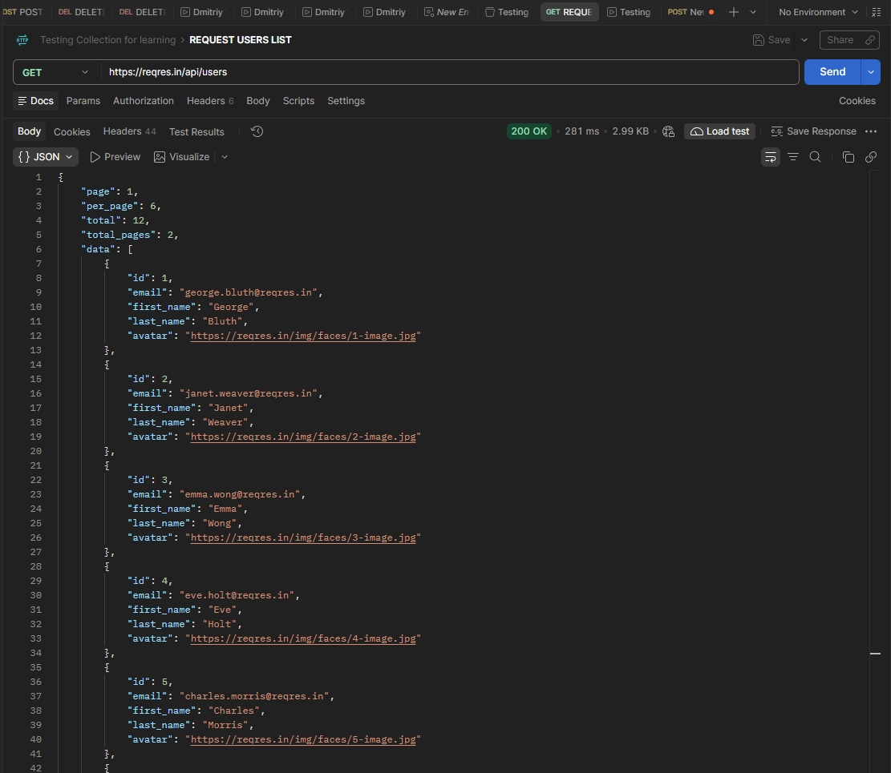
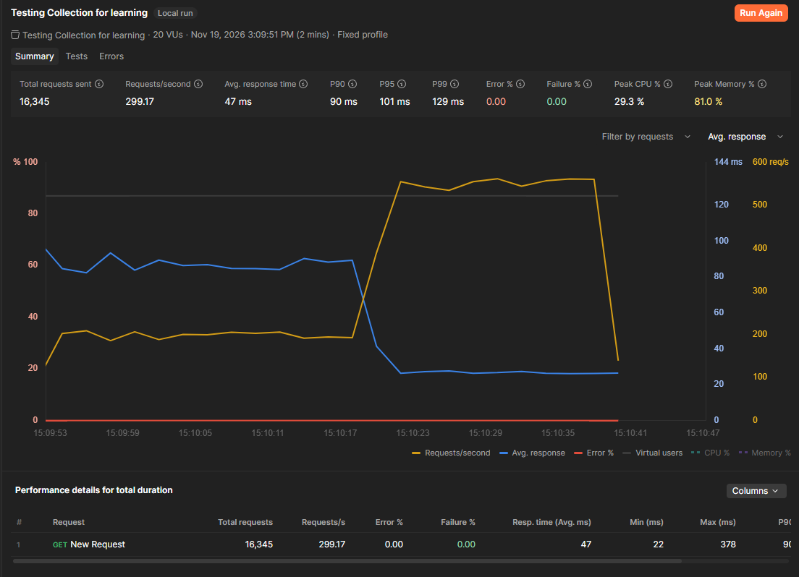

# API Functional & Stress Testing — ReqRes REST API

> ℹ️ **Practice Case Note:** Hands-on API testing pet-project focused on verifying 
> RESTful endpoints and conducting high-volume stress testing using Postman. 
> Testing approach and metrics reflect my actual practical run.

## Project Info
- **Project type:** Public REST API sandbox for testing & prototyping (`reqres.in`)
- **My role:** Junior Manual QA Engineer (API testing, load & stress testing)
- **Period:** 19.11.2026
- **Tools:** Postman (Collections, Collection Runner, Performance / Load Testing)

## Task / Context
Testing the **user retrieval endpoint** (`GET /api/users`) and evaluating API stability 
under **high-volume stress load** in Postman.

My task was to verify that the endpoint returns valid status codes and expected JSON 
structure (`200 OK`, pagination fields, and user objects), and then measure how the 
service handles an intensive run of over 16,000 requests with 299 concurrent requests.

## Test Cases & Results

### TC-01: Retrieve paginated list of users via GET request
| Field | Value |
|-------|-------|
| **Steps** | 1. Open Postman and create a `GET` request to `https://reqres.in/api/users?page=1`. 2. Send the request. 3. Inspect HTTP status code, response headers, and JSON body. |
| **Expected** | The API returns status code `200 OK` and a JSON payload containing pagination metadata (`page`, `per_page`, `total`, `total_pages`) and a `data` array with user details. |
| **Actual** | The API returned `200 OK` with the expected pagination structure (`page: 1`, `per_page: 6`, `total: 12`, `total_pages: 2`) and valid user data. |
| **Result** | ✅ **Passed** |
| **Comments** | Functional check succeeded; response schema and status code match expectations. |
| **Attachments** |  |

## Summary of Results
| Test Case | Result |
|-----------|--------|
| TC-01 | ✅ Passed |

**Passed:** 1 of 1 — functional `GET` check completed without errors.

## Stress Test Log

### LOAD-01: High-volume stress test on GET endpoint via Postman Runner
| Field | Value |
|-------|-------|
| **Total Requests** | 16,345 |
| **Requests (Runner config)** | 299 |
| **Error Rate** | 0% (0 failed requests) |
| **Response Time (AVG)** | 47 ms |
| **Response Time (Min / Max)** | 22 ms / 378 ms |
| **Percentiles** | p90: 90 ms \| p95: 101 ms \| p99: 129 ms |

**Comments:**
1. Across 16,345 total requests and 0% error rate, the endpoint maintained low latency with an average response time of 47 ms.
2. Tail percentiles (`p90` at 90 ms, `p95` at 101 ms, `p99` at 129 ms) remained consistent during the test run.

**Attachments:**

## Conclusion
This case was a practical exercise in **API Functional Verification** and **Stress Testing** using Postman.

By combining a baseline `GET` request check with a high-volume run of 16,345 requests, I verified both response correctness (`200 OK`) and latency behavior (`47 ms` average, `0%` errors).

Tracking averages alongside `p90`, `p95`, and `p99` percentiles helps evaluate real stability under load rather than relying on a single response snapshot.
