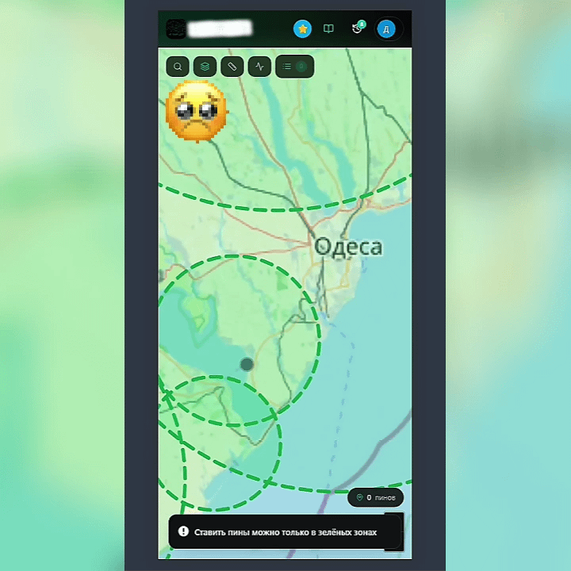

# Smoke Test Failure: Marker Creation Blocked — Commercial Project (Anonymized)

> ⚠️ **NDA Notice:** Project name, URLs, city names and sensitive data are 
> anonymized. Testing approach and artifacts reflect my actual contribution.

## Project Info
- **Project type:** Map-based mobile & web application with store markers (pins) on an interactive map
- **My role:** Manual QA / Beta Tester (exploratory testing, part-time, parallel with education)
- **Period:** 03.09.2026
- **Tools:** DevTools, screen recording, Testiny

## Task / Context
Performing a **Smoke Test** (basic functionality check) on a new build. 
The primary goal of a smoke test is to verify that the most critical 
features work and that the build is stable enough for further, deeper testing.

**Smoke Test Scope:** Verify that a user can open the map and place a marker 
within the supported "green zone" (designated service area).

## Test Cases & Results

### TC-01: Adding a marker within the designated green zone
| Field | Value |
|-------|-------|
| **Steps** | 1. Open the map and ensure user limits are available. 2. Move the map center or click anywhere inside the designated green zone. 3. Attempt to save the new marker. |
| **Expected** | The marker is successfully placed, and a confirmation modal appears. |
| **Actual** | Markers cannot be placed inside the green zone. The creation action fails immediately, making it impossible to use the core feature of the app. |
| **Result** | ❌ **Failed (Blocker)** — defect found (see BUG-002) |
| **Comments** | This is a **showstopper**. Since the primary function (marker creation) is completely broken, further testing of the map module is blocked. The build is not ready for regression testing. |
| **Attachments** |  |

## Summary of Results
| Test Case | Result |
|-----------|--------|
| TC-01 | ❌ Failed (Smoke test failed) |

**Not passed:** 1 of 1. The smoke test is considered failed due to a critical blocker.

## Defect Log

### BUG-002: Unable to create markers within the allowed green zone (Blocker)
| Field | Value |
|-------|-------|
| **Severity** | Critical / Blocker |
| **Priority** | Highest |
| **Status** | Open / Reported |
| **Environment** | Web / Mobile app |

**Steps to reproduce:**
1. Open the app and go to the map.
2. Ensure the user has available marker limits.
3. Try to place a marker inside the designated green zone (supported area).

**Expected:** The marker is successfully placed, and the user can proceed to interact with it.
**Actual:** The marker cannot be placed at all. The action fails, blocking the primary user flow.

**Comments:** 
1. The core functionality is broken. Without the ability to add markers, the application cannot be used for its intended purpose. 
2. **Smoke Test failed:** Regression testing on this build has been suspended until this issue is resolved.

**Attachments:** 
| **Attachments** |  |

## Conclusion
This case was a practical lesson in **Smoke Testing** and understanding **severity vs. priority**. 

While exploring the new build, I immediately encountered a blocking issue that prevented the creation of any markers, even within the valid zone. Recognizing this as a **Blocker**, I immediately halted further testing of the map features. 

Reporting a smoke test failure early saves the entire team time — it prevents QA from wasting hours on a broken build and alerts the developers immediately so they can fix the core issue before the next iteration.

## Proof
[Video with blurred data](./videos/smoke-marker-blocked.mp4)
