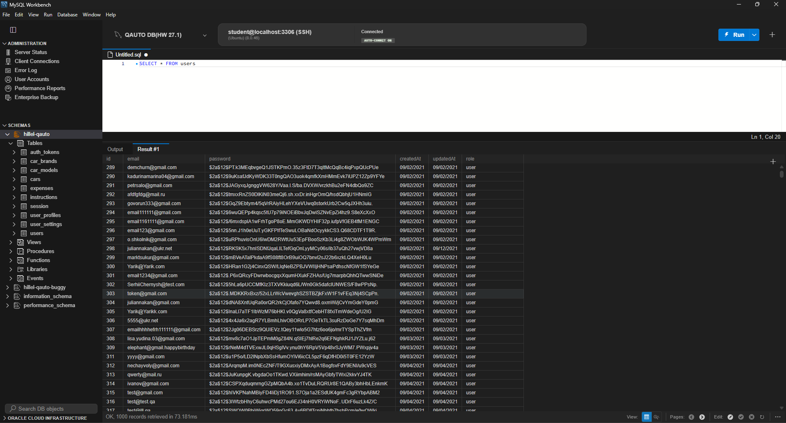
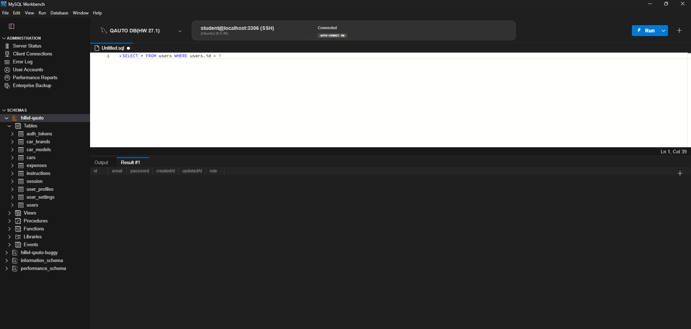
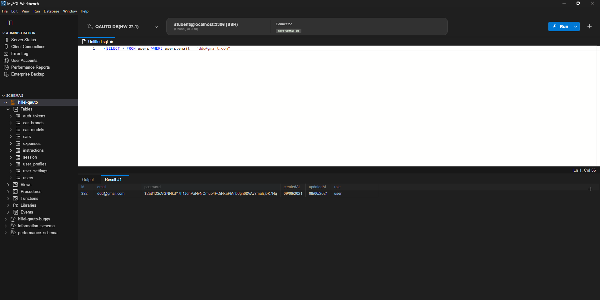
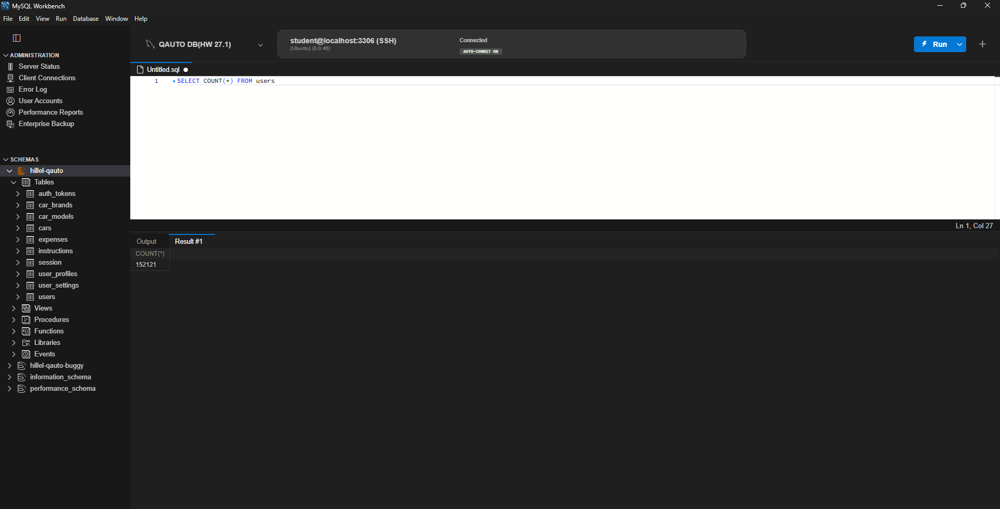
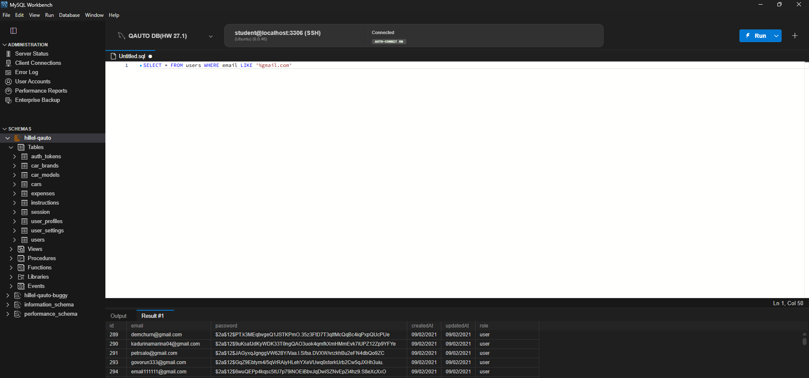
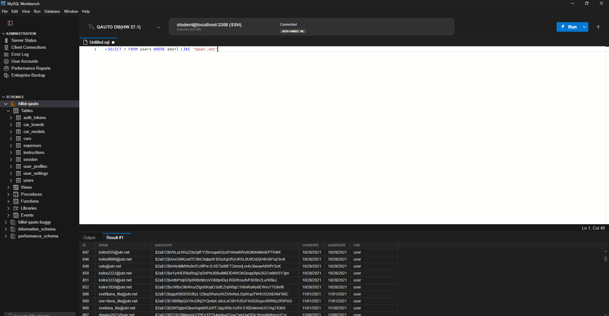
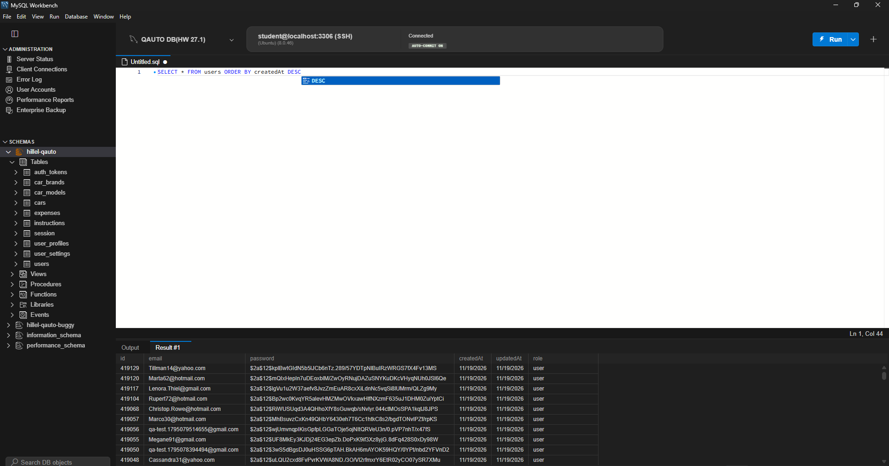
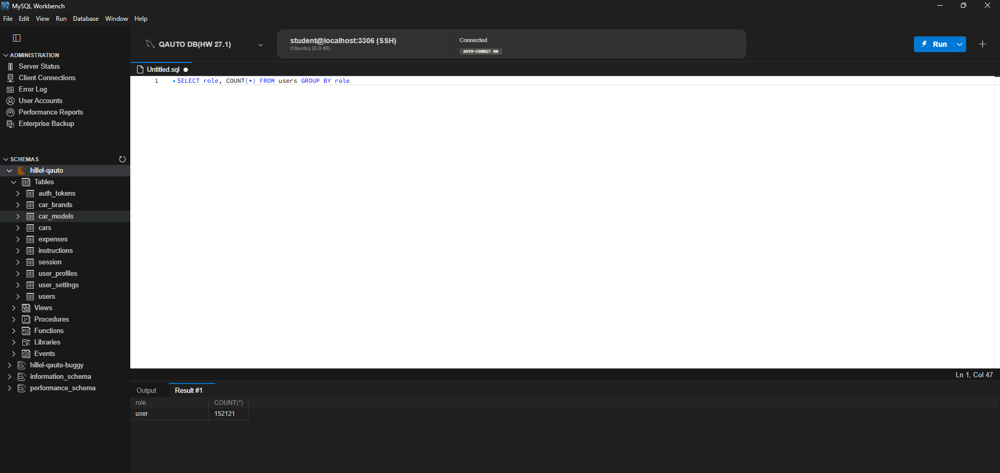

# SQL Practice & Data Verification — Users Database

> ℹ️ **Practice Case Note:** Hands-on SQL querying practice focused on data retrieval, filtering, boundary/negative checks, pattern matching, sorting, and aggregation.

## Project Info
- **Database / Source:** Hillel QA Auto (MySQL)
- **Target Table:** `users` (`id`, `email`, `password`, `created_at`, `updated_at`, `role`)
- **My role:** Junior Manual QA Engineer (practice & portfolio documentation)
- **Tools:** MySQL CLI / Workbench, screen recording / screenshots

## Task / Context
Practicing core SQL querying on the `users` table to verify data retrieval, handling of non-existent records, exact and wildcard email filtering, result ordering, and role-based aggregation.

## Test Cases & Results

### TC-01: Retrieve all user records
| Field | Value |
|-------|-------|
| **SQL Query** | `SELECT * FROM users;` |
| **Steps** | 1. Connect to the database and select the `users` table. 2. Execute `SELECT * FROM users;`. |
| **Expected** | Returns all rows and columns (`id`, `email`, `password`, `created_at`, `updated_at`, `role`) from `users`. |
| **Actual** | All user records and table columns are returned and displayed. |
| **Result** | ✅ **Passed** |
| **Comments** | Verified full table schema and sample data. |
| **Attachments** |  |

### TC-02: Boundary / Negative check — Search non-existent user (`ID = 7`)
| Field | Value |
|-------|-------|
| **SQL Query** | `SELECT * FROM users WHERE users.id = 7;` |
| **Steps** | 1. Execute `SELECT * FROM users WHERE users.id = 7;`. 2. Check the returned result set. |
| **Expected** | Empty result set (0 rows returned) with table column headers intact. |
| **Actual** | No record with `id = 7` found; 0 rows returned with column headers displayed. |
| **Result** | ✅ **Passed** |
| **Comments** | Confirms no false match or error when querying an absent ID. |
| **Attachments** |  |

### TC-03: Exact match filtering by email (`ddd@gmail.com`)
| Field | Value |
|-------|-------|
| **SQL Query** | `SELECT * FROM users WHERE users.email = 'ddd@gmail.com';` |
| **Steps** | 1. Execute `SELECT * FROM users WHERE users.email = 'ddd@gmail.com';`. 2. Verify the returned record. |
| **Expected** | Returns the user record matching `'ddd@gmail.com'`. |
| **Actual** | Matching user record found and displayed. |
| **Result** | ✅ **Passed** |
| **Comments** | Exact string comparison in single quotes works as expected. |
| **Attachments** |  |

### TC-04: Aggregate total count of users (`COUNT(*)`)
| Field | Value |
|-------|-------|
| **SQL Query** | `SELECT COUNT(*) FROM users;` |
| **Steps** | 1. Execute `SELECT COUNT(*) FROM users;`. 2. Read the total row count. |
| **Expected** | Returns the exact total number of rows in `users`. |
| **Actual** | Returned total count: `152,121`. |
| **Result** | ✅ **Passed** |
| **Comments** | Useful baseline check before filtering or aggregating subsets. |
| **Attachments** |  |

### TC-05: Pattern matching (`LIKE`) for `@gmail.com`
| Field | Value |
|-------|-------|
| **SQL Query** | `SELECT * FROM users WHERE email LIKE '%gmail.com';` |
| **Steps** | 1. Execute `SELECT * FROM users WHERE email LIKE '%gmail.com';`. 2. Inspect returned email addresses. |
| **Expected** | Returns all users whose `email` ends with `gmail.com`. |
| **Actual** | Filtered list of `@gmail.com` users returned. |
| **Result** | ✅ **Passed** |
| **Comments** | Leading `%` wildcard matches any prefix before `gmail.com`. |
| **Attachments** |  |

### TC-06: Pattern matching (`LIKE`) for `@ukr.net`
| Field | Value |
|-------|-------|
| **SQL Query** | `SELECT * FROM users WHERE email LIKE '%ukr.net';` |
| **Steps** | 1. Execute `SELECT * FROM users WHERE email LIKE '%ukr.net';`. 2. Inspect returned email addresses. |
| **Expected** | Returns all users whose `email` ends with `ukr.net`. |
| **Actual** | Filtered list of `@ukr.net` users returned. |
| **Result** | ✅ **Passed** |
| **Comments** | Verified wildcard pattern reuse across a different email domain. |
| **Attachments** |  |

### TC-07: Sort records by registration date descending (`ORDER BY created_at DESC`)
| Field | Value |
|-------|-------|
| **SQL Query** | `SELECT * FROM users ORDER BY created_at DESC;` |
| **Steps** | 1. Execute `SELECT * FROM users ORDER BY created_at DESC;`. 2. Check top-to-bottom ordering of `created_at`. |
| **Expected** | Records are sorted from newest to oldest by `created_at` (`DESC`). |
| **Actual** | Records sorted in descending order by `created_at`. |
| **Result** | ✅ **Passed** |
| **Comments** | `DESC` sorts newest first; `ASC` sorts oldest first. |
| **Attachments** |  |

### TC-08: Group by `role` and count users per role (`GROUP BY role`)
| Field | Value |
|-------|-------|
| **SQL Query** | `SELECT role, COUNT(role) FROM users GROUP BY role;` |
| **Steps** | 1. Execute `SELECT role, COUNT(role) FROM users GROUP BY role;`. 2. Check each role and its count. |
| **Expected** | Returns each distinct `role` along with the count of records in that role. |
| **Actual** | Grouped summary returned (`user` role count around `152,000+`). |
| **Result** | ✅ **Passed** |
| **Comments** | Selecting non-aggregated extra columns with `GROUP BY role` can trigger error `1055` in strict SQL mode, so selecting `role` and `COUNT(role)` avoids it. |
| **Attachments** |  |

## Summary of Results
| Test Case | Result |
|-----------|--------|
| TC-01 | ✅ Passed |
| TC-02 | ✅ Passed |
| TC-03 | ✅ Passed |
| TC-04 | ✅ Passed |
| TC-05 | ✅ Passed |
| TC-06 | ✅ Passed |
| TC-07 | ✅ Passed |
| TC-08 | ✅ Passed |

**Passed:** 8 of 8.

## Conclusion
This practice case covers essential SQL verification skills for manual QA: reading full datasets, checking missing records, filtering exact values and domain patterns (`LIKE`), sorting timestamps (`ORDER BY ... DESC`), and aggregating counts by category (`GROUP BY` + `COUNT`).

Being able to run quick SQL checks helps validate backend/database state directly during test execution instead of relying only on the UI.
