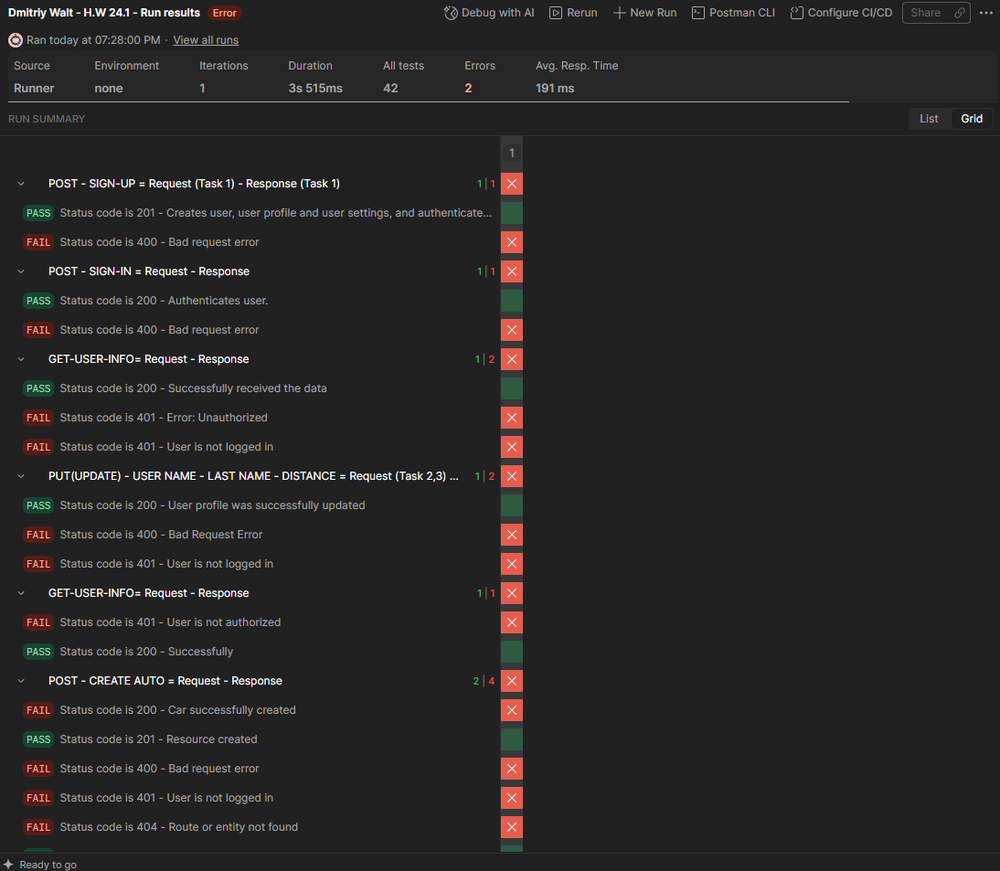
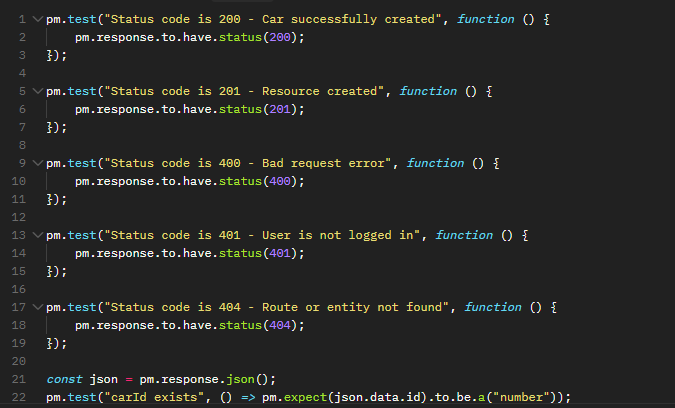
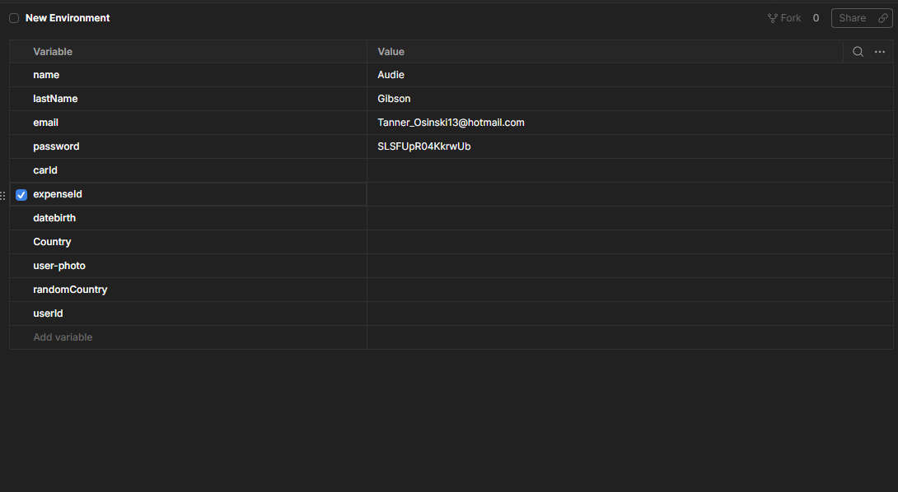
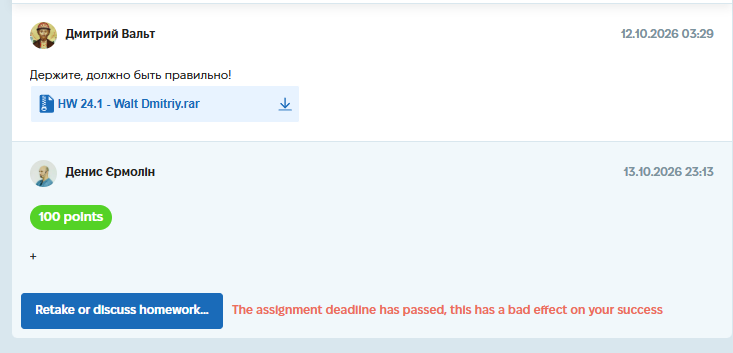

# Case Study: API Testing with Postman (End-to-End Flow)

**Project:** "hillelAuto" Web Application (Educational Project)

**Task:** Create a Postman collection to test the full user lifecycle, including creating a user, updating profile data, managing cars and expenses, and cleaning up test data.

**Tools Used:** Postman / JavaScript (for assertions) / JSON.

**Date Completed:** 12.10.2026

---

## 📝 Project Context & Overview
This assignment focused on testing the backend API of the hillelAuto application. The goal was to build an automated end-to-end business flow: from user registration to deletion. A critical requirement was ensuring the collection runs repeatedly without conflicts, meaning a new unique user must be generated automatically on every run.

## 🛠 My Approach & Deliverables

I built a sequential Postman collection divided into 8 logical tasks. Each request relies on data generated by the previous one. I used Pre-request Scripts and Tests (assertions) to validate responses and pass data dynamically via Environment Variables.

### 🔄 1. End-to-End Test Flow
The collection covers the full lifecycle of a user and their vehicle:
1.  **Create User:** Registered a new user via `POST /auth/signup` and authenticated via `POST /auth/signin`.
2.  **Update Profile:** Changed the user's First Name and Last Name via `PUT /users/profile`.
3.  **Change Distance Unit:** Updated the user's preferred distance measurement to miles (ml).
4.  **Add Car:** Added a new vehicle to the user's profile via `POST /cars`.
5.  **Update Mileage:** Changed the mileage of the added car.
6.  **Add Expense:** Created an expense record for the car.
7.  **Delete Car:** Removed the vehicle from the user's profile.
8.  **Delete User:** Cleaned up the test data by deleting the user.

### ⚙️ 2. Dynamic Data Generation (Pre-request Script)
To meet the requirement of creating a unique user every time, I utilized Postman's built-in dynamic variables inside the Pre-request Script of the first request:
*   Generated random data using `pm.variables.replaceIn('{{$randomEmail}}')`, `{{$randomFirstName}}`, `{{$randomLastName}}`, and `{{$randomPassword}}`.
*   Saved these values to Environment Variables so they could be used in subsequent requests.

### ✅ 3. Assertions (JSON Value Checks)
Every request includes a "Tests" tab with JavaScript assertions. I did not just rely on HTTP status codes, but also checked the response body and extracted IDs.

Examples of assertions used:
*   **Status Code Validation:** `pm.test("Status code is 201", function () { pm.response.to.have.status(201); });`
*   **Data Extraction:** Saved the newly created `carId` and `expenseId` to Environment Variables using `pm.environment.set("carId", json.data.id);`.
*   **JSON Value Check:** Verified that the data type is correct, e.g., `pm.expect(json.data.id).to.be.a("number");`.

### 🌿 4. Collection Runner
I configured the Collection Runner to execute the entire folder sequentially. Because the Environment Variables are updated automatically after each request, the runner successfully completes the full cycle without manual intervention.

## 🐞 Examples of Implemented Requests (from Collection)

**1. User Creation (POST /auth/signup)**
*   **Body:** Dynamic variables for name, lastName, email, password.
*   **Test:** Checks for `201 Created` status.

**2. Add Car (POST /cars)**
*   **Body:** `{"carBrandId": 1, "carModelId": 1, "mileage": 122}`
*   **Test:** Checks for `200 OK`, verifies `carId` exists, and saves it to the environment.

**3. Add Expense (POST /expenses)**
*   **Body:** `{"carId": {{carId}}, "reportedAt": "2026-10-11", "mileage": 777999, "liters": 11, "totalCost": 11}`
*   **Test:** Checks for `200 OK`, extracts `expenseId`, and saves it to the environment.

## 📸 Proof of Work
*(Screenshots of the Postman Collection Runner and Test results)*

**Collection Runner Results:**

**Example of Tests (Assertions):**

**Environment Variables:**

## 💡 Conclusion
This task allowed me to practice the full API testing cycle: from chaining requests and managing environment variables to writing JavaScript assertions for JSON validation. I learned that generating dynamic data via Pre-request Scripts is crucial for making automated test suites reliable and repeatable.

*(Screenshot of the completed assignment and feedback)*

