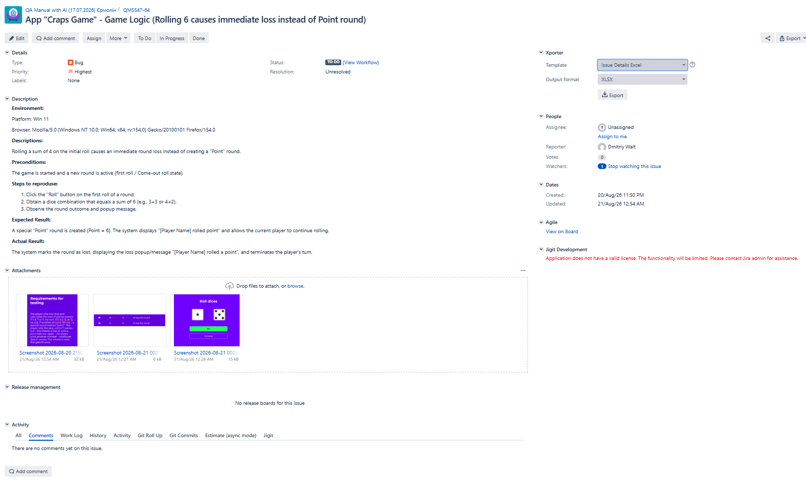
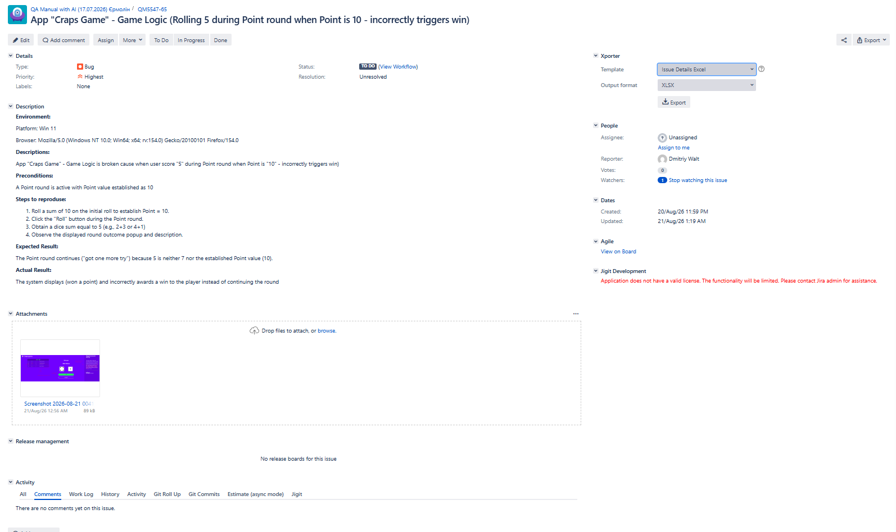
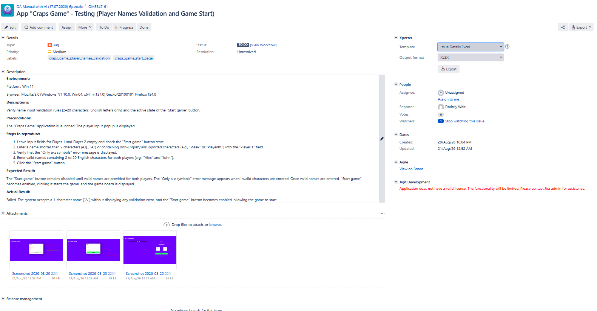
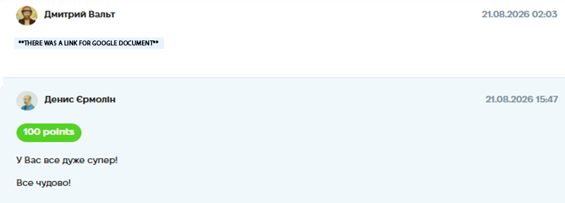

# Case Study: Checklist Execution & Bug Reporting

**Project:** "Craps Game" Web Application (Educational Project)
**Task:** Execute the test checklist, identify defects, and log them as formal Bug Reports in Jira.
**Tools Used:** Jira (Bug Tracking) / Google Docs (Checklist).
**Date Completed:** 21.08.2026 02:03

---

## 📝 Project Context & Overview
After creating the test checklist, my next step was to execute it and document deviations from the requirements. The goal was to write clear, reproducible bug reports that a developer could easily understand and fix.

## 🛠 My Approach & Deliverables

I executed the 11-section checklist, focusing on player validation, game logic (dice rolls), and mobile UI. Below are 3 examples of the bug reports I created in Jira, demonstrating my ability to document both logic errors and validation issues.

### 🐞 Bug Report 1: Name Validation Issue
*   **Jira ID:** QM5547-61
*   **Title:** App "Craps Game" - Testing (Player Names Validation and Game Start)
*   **Environment:** Windows 11, Firefox 154.0
*   **Preconditions:** The game is launched, and the player input popup is displayed.
*   **Steps to Reproduce:**
    1. Leave input fields for Player 1 and Player 2 empty (check disabled state).
    2. Enter a name shorter than 2 characters (e.g., "A") into Player 1.
    3. Verify that the "Only a-z symbols" error message is displayed.
    4. Enter valid names (2-20 chars) for both players and click "Start game".
*   **Expected Result:** "Start game" remains disabled until valid names are provided. Error message triggers on invalid input.
*   **Actual Result:** The system accepts a 1-character name ("A") without displaying a validation error, and the "Start game" button becomes enabled, allowing the game to start.
*   **Priority:** Medium

### 🐞 Bug Report 2: Game Logic - Incorrect Loss
*   **Jira ID:** QM5547-64
*   **Title:** Game Logic (Rolling 6 causes immediate loss instead of Point round)
*   **Environment:** Windows 11, Firefox 154.0
*   **Preconditions:** The game is started, and a new round is active (first roll).
*   **Steps to Reproduce:**
    1. Click "Roll" on the first roll of a round.
    2. Obtain a dice combination that equals a sum of 6 (e.g., 3+3 or 4+2).
    3. Observe the round outcome and popup message.
*   **Expected Result:** A special "Point" round is created (Point = 6). The system displays "[Player Name] rolled point" and allows rolling to continue.
*   **Actual Result:** The system marks the round as lost, displaying the lose popup and terminating the player's turn.
*   **Priority:** Highest

### 🐞 Bug Report 3: Game Logic - Incorrect Win
*   **Jira ID:** QM5547-65
*   **Title:** Game Logic (Rolling 5 during Point round when Point is 10 - incorrectly triggers win)
*   **Environment:** Windows 11, Firefox 154.0
*   **Preconditions:** A Point round is active with a Point value established as 10.
*   **Steps to Reproduce:**
    1. Roll a sum of 10 on the initial roll to establish Point = 10.
    2. Click "Roll" during the Point round.
    3. Obtain a dice sum equal to 5 (e.g., 2+3 or 4+1).
    4. Observe the displayed round outcome.
*   **Expected Result:** The Point round continues ("got one more try") because 5 is neither 7 (loss) nor the established Point 10 (win).
*   **Actual Result:** The system displays "(won a point)" and incorrectly awards a win to the player instead of continuing the round.
*   **Priority:** Highest

## 📸 Proof of Work
*(Screenshot of the Jira Board with reported bugs)*

## 💡 Conclusion
This task allowed me to practice the full QA cycle: from executing a checklist to creating structured bug reports in Jira. I learned that logical bugs (like incorrect game rules) require very detailed "Steps to Reproduce", while validation bugs require clear "Expected vs Actual" comparisons.

*(Screenshot of the completed assignment and feedback)*

