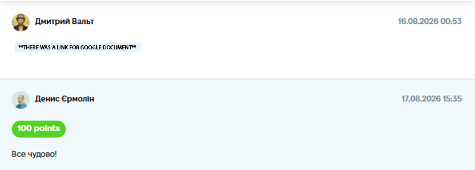

# Case Study: Checklist Creation & Execution for a Game Application

**Project:** "Craps Game" Web Application (Educational Project)
**Task:** Create a comprehensive checklist based on requirements, execute it, and log the results (including mobile testing).
**Tools Used:** Google Docs (Checklist creation & execution).
**Date Completed:** 16.08.2026 00:53

---

## 📝 Project Context & Overview
The goal was to verify the core functionality, game logic, and UI of the "Craps Game" application. Unlike test cases (which are step-by-step), a checklist allows for faster, high-level validation of multiple scenarios.

## 🛠 My Approach & Deliverables

I created a structured checklist covering **11 major sections**:
1.  **Beginning of the Game:** Verifying title, player input popups, and default state of the "Start game" button.
2.  **Player Name Validation:** Testing English chars only, min/max length (2-20 chars), Cyrillic inputs, and error messages.
3.  **Game Round Start:** Checking turn indicators and dice display.
4.  **Dice Roll:** Verifying random values and sum calculation.
5.  **Dice Roll Result Logic:** Checking win/lose conditions (7, 11 vs 2, 8, 12) and point establishment.
6.  **Point Round:** Verifying game continuation, win/lose conditions during the point round.
7.  **Turns Result Popup:** Ensuring correct text and names are displayed.
8.  **Results Table:** Checking columns (Name, Score, Description) and dynamic updates.
9.  **End Game / Reset Game:** Verifying popup texts and reset logic.
10. **Winning the Game:** Checking the 10-win condition and "Start new game" flow.
11. **UI / Mobile:** Verifying responsive design and element visibility.

## 🐞 Bugs Found During Execution
While executing the checklist, I found several issues that required logging (marked as FAILED):

*   **Name Validation Bug:** When entering a name shorter than 2 characters (e.g., 1 char), the validation error did not trigger correctly.
*   **Game Logic (Point Round):** When rolling certain numbers (e.g., 3, 4, 5, 6, 9, 10) during the first roll, the point round logic had inconsistencies.
*   **Mobile UI/UX Issues (Responsive Design):**
    *   Popups are displayed incorrectly on mobile screens (cut off or overlapping).
    *   Main buttons (Roll, End game) are misaligned.
    *   The results table overflows the screen and is not readable on small devices.

## 💡 Conclusion
Executing this checklist allowed me to validate all critical game logic quickly. The most valuable finding was the **UI/UX issues on mobile devices**, which were not visible on the desktop version. This highlights the importance of cross-platform testing.

## 📸 Proof of Work
*(Screenshot of the completed assignment and feedback)*

