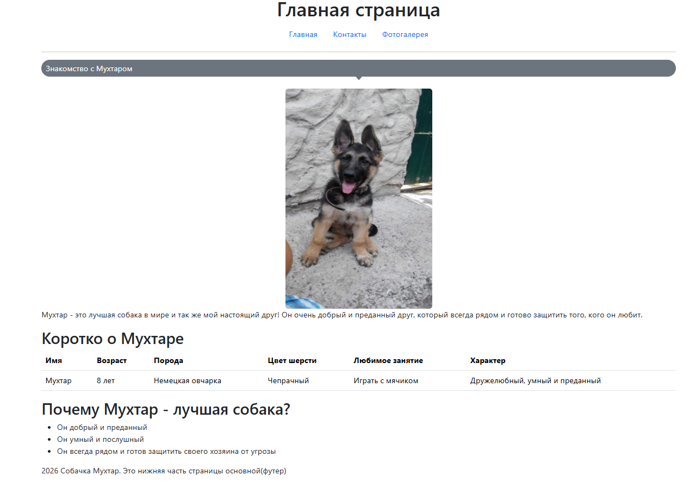
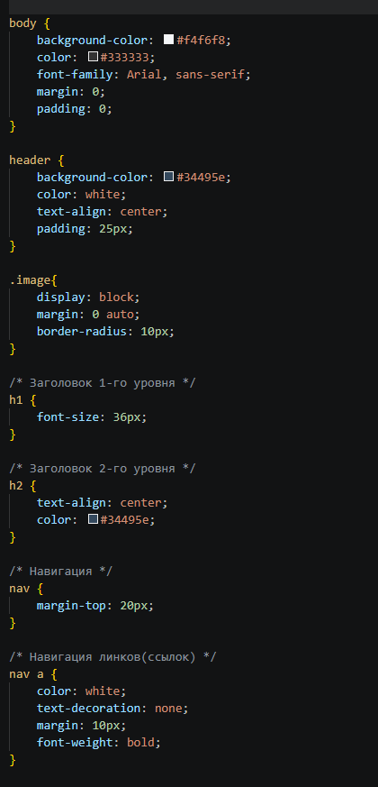
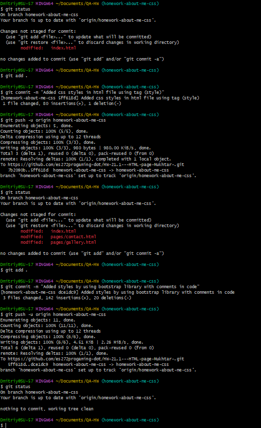
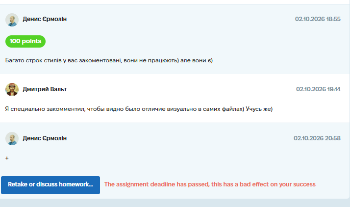

# Case Study: CSS Styling & Responsive Design

**Project:** "About Me" Personal Web Page (Educational Project)
**Task:** Enhance the existing HTML website by adding external CSS styles, using `id` and `class` attributes for targeting, and managing the project via a separate Git branch.
**Tools Used:** CSS3 / HTML5 / Git / GitHub.
**Date Completed:** 02.10.2026

---

## 📝 Project Context & Overview
This assignment was the next logical step after building the raw HTML structure. The goal was to transform the plain HTML page into a visually appealing website by applying external CSS. The task required creating a separate `style.css` file, linking it to all HTML pages, and using `id` and `class` attributes to target specific elements.

## 🛠 My Approach & Deliverables

I approached this by creating a dedicated CSS file, building a consistent visual theme, and using CSS selectors to style the content. I also documented my learning process directly in the code using comments.

### 🎨 1. External CSS Implementation
Following best practices, I did not use inline styles or `<style>` blocks. Instead, I created a single `style.css` file and linked it to `index.html`, `pages/contact.html`, and `pages/gallery.html` using the `<link>` tag.

### 🏷️ 2. Using Classes and IDs
To apply styles efficiently, I added `class` and `id` attributes to the HTML elements:
*   **Classes** (e.g., `.container`, `.nav-link`, `.photo-item`): Used for styling multiple elements with the same visual characteristics.
*   **IDs** (e.g., `#main-header`, `#contact-form`): Used for unique elements on the page that required specific styling.

### 💅 3. CSS Styling Techniques
I applied the following CSS concepts learned during the lectures:
*   **Typography:** Adjusted `font-family`, `font-size`, `color`, and `text-align` to make the content readable.
*   **Box Model:** Used `margin`, `padding`, and `border` to create spacing and visual separation between elements.
*   **Backgrounds:** Applied background colors and images to different sections.
*   **Layout:** Used basic layout techniques to structure the page content.

### 🌿 4. Git Workflow
I followed the required Git workflow:
1.  Created a new feature branch: `homework-about-me-css`.
2.  Committed the CSS changes separately from the HTML changes.
3.  Pushed the branch to the remote repository on GitHub.

### 💡 5. A Note on Commented Code
As discussed with the instructor, some CSS rules in the `style.css` file are intentionally commented out (`/* ... */`). This was done for educational and comparative purposes, to visually demonstrate the difference between the styled and unstyled versions of the elements directly in the code. This reflects my hands-on approach to learning and exploring CSS properties.

## 📸 Proof of Work

**Styled Main Page:**

**CSS File Structure:**

**Git Branch Verification:**

## 💡 Conclusion
This task helped me understand the separation of concerns (HTML for structure, CSS for presentation) and how to use external stylesheets effectively. I also learned the importance of clean Git branching. Commenting out code for comparison turned out to be a useful learning tool that also helped me explain my thought process to the instructor.

*(Screenshot of the completed assignment and feedback)*

