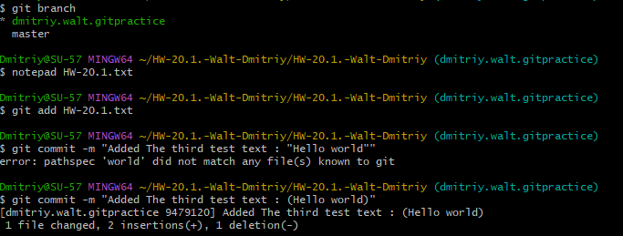
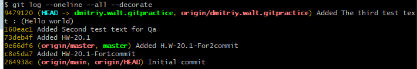
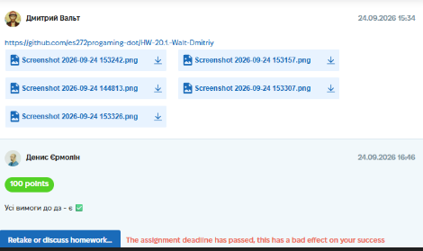

# Case Study: Git Basics & Version Control

**Project:** Personal Git Practice (Educational Project)
**Task:** Create a public GitHub repository, clone it locally, make commits, create a new branch, push changes, and practice version control workflows.
**Tools Used:** Git Bash, GitHub.
**Date Completed:** 24.09.2026 15:34

---

## 📝 Project Context & Overview
As a QA Engineer, I need to not only find bugs but also understand how code is managed. This assignment was designed to practice essential Git commands required for daily collaboration with developers and version control of test documentation (or code).

## 🛠 My Approach & Deliverables

I performed the following Git operations from the command line:

### 1. Repository Initialization & Setup
*   Created a public repository on GitHub.
*   Initialized a local repository using `git init`.
*   Cloned the remote repository to my local machine.

### 2. Committing Changes (Version Control)
*   Created a new text file.
*   Added files to the staging area using `git add`.
*   Made multiple commits with descriptive messages (e.g., *"Added HW-20.1"*, *"Added The third test text"*) using `git commit -m`.

### 3. Branching & Pushing
*   Created a new branch using `git branch [branch_name]` and switched to it.
*   Made additional changes and committed them.
*   Pushed the new branch to the remote GitHub repository using `git push -u origin [branch_name]`.

*(Screenshot of the terminal showing Git commands and branch creation)*

*(Screenshot of the Git log showing commit history and branch tracking)*

## 📸 Proof of Work
*(Screenshot of the completed assignment and feedback)*

## 💡 Conclusion
Mastering Git basics is essential for modern QA. This practice demonstrated my ability to:
1. Manage local and remote repositories.
2. Track changes with commits.
3. Work with branches (crucial for testing new features in isolation).
4. Push code/documentation to GitHub.
