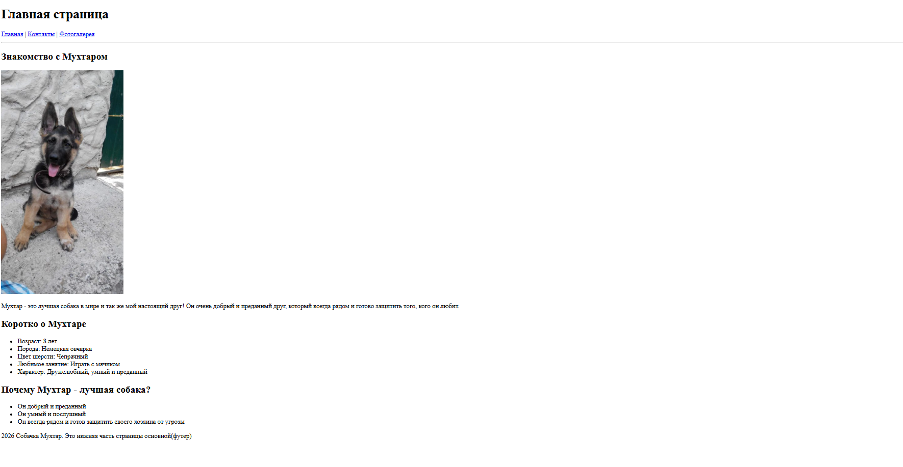
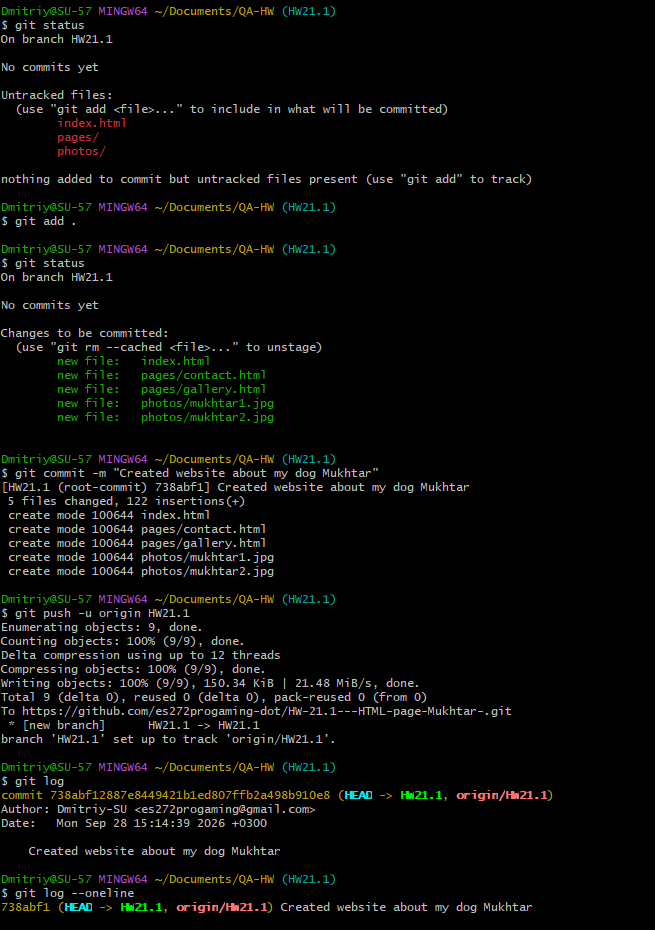
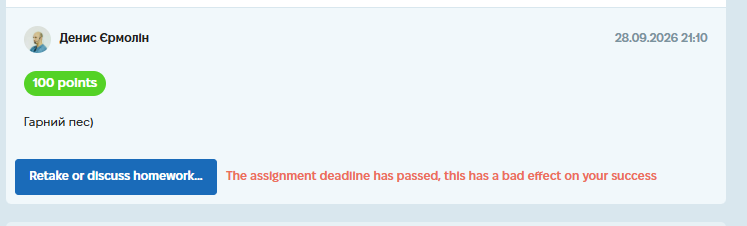

# Case Study: HTML Structure & Git Branching

**Project:** "About Me" Personal Web Page (Educational Project)
**Task:** Create a multi-page HTML website without CSS, structured in folders, and managed via Git branches.
**Tools Used:** HTML5 / Git / GitHub / Markdown.
**Date Completed:** 28.09.2026 15:19

---

## 📝 Project Context & Overview
This task was designed to test foundational web technologies and version control discipline. The goal was to build a simple biographical webpage strictly using raw HTML tags (no CSS allowed) while adhering to a specific file hierarchy. Additionally, the task required proper Git workflow - creating a separate branch (`HW21.1`) and pushing changes to a remote repository.

## 🛠 My Approach & Deliverables

I approached this by first creating the required directory structure locally, writing the HTML files with semantic tags, and then using Git to manage the versioning. Below are the key deliverables and how I met the technical requirements.

### 📂 1. Project Structure Compliance
The task had strict requirements regarding folder hierarchy. I organized the project as follows:
*   `index.html` - Main page (located in the root).
*   `pages/contact.html` - Contact page.
*   `pages/gallery.html` - Gallery page.
*   `photo/` - Directory containing all image assets.

### 💻 2. Technical Implementation (Pure HTML)
I used only tags covered during the lectures, avoiding any inline styles (`style="..."`) or `<style>` blocks, as required by the task.

*   **Navigation:** Implemented using `<a href="...">` links to navigate between the main page and subpages.
*   **Content:** Used `<h1>`, `<h2>` for headings, `
` for text blocks, `<ul>` / `<li>` for lists, and `` for photos with `alt` attributes.
*   **No CSS:** The page relies on default browser rendering, proving a solid understanding of raw HTML structure.

### 🌿 3. Git Workflow
Instead of committing directly to the `main` branch (which is a bad practice), I followed the proper Git-flow:
1.  Created a new feature branch: `HW21.1`.
2.  Added all HTML files and images to the staging area.
3.  Committed the changes.
4.  Pushed the branch to the remote repository on GitHub.

## 📸 Proof of Work
*(Screenshots of the final code structure and the rendered pages)*

**Main Page (index.html):**

**Git Branch Verification:**

## 💡 Conclusion
This task allowed me to reinforce my understanding of HTML document structure and relative file paths. More importantly, it helped me practice using Git branches — a crucial skill for team collaboration and version control. I learned that even simple projects benefit from clear folder organization, which makes navigation and maintenance much easier.

*(Screenshot of the completed assignment and feedback)*

