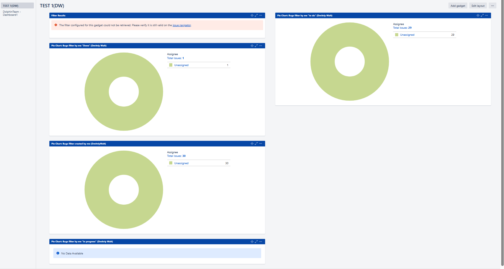
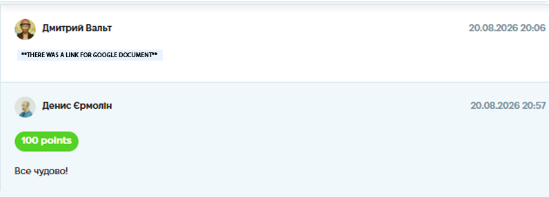

# Case Study: Jira Filters & Dashboard Creation

**Project:** Jira Workspace (Educational Project)
**Task:** Create custom Jira filters based on specific criteria and build a visual dashboard to monitor project status and bug distribution.
**Tools Used:** Jira Software (JQL, Dashboards, Gadgets).
**Date Completed:** 20.08.2026 20:06

---

## 📝 Project Context & Overview
The goal was to practice working with Jira's search and visualization tools. As a QA, I need to be able to quickly find my assigned tasks, track the status of bugs I've created, and visualize this data for the team (or for personal reporting).

## 🛠 My Approach & Deliverables

### 1. Creating JQL Filters
I created a set of custom filters to track specific issues. Using Jira Query Language (JQL) and the basic search UI, I filtered out:
*   All bugs created by me.
*   All bugs created by me in the "To Do" status.
*   All bugs in the "In Progress" status.
*   All bugs in the "Done" status.
*   All tasks assigned to me.

### 2. Building the Dashboard
Once the filters were created, I added them to a custom Dashboard using visual **Gadgets**:
*   **Filter Results Gadget:** Added to view a list of filtered issues (though one filter was intentionally left invalid to test the error handling of the gadget).
*   **Pie Charts:** Created multiple Pie Chart gadgets to visualize:
    *   Distribution of my tasks by status (To Do, In Progress, Done).
    *   All bugs created by me (grouped by Assignee).
    *   Bugs created by me that are currently "To Do".

*(Visual representation of the Jira Dashboard)*

## 💡 Conclusion
Working with Jira filters and dashboards allowed me to practice **data visualization and project monitoring**. It also helped me understand how to quickly find specific issues (e.g., my active bugs) and present that data clearly for reporting purposes.

## 📸 Proof of Work
*(Screenshot of the completed assignment and feedback)*

