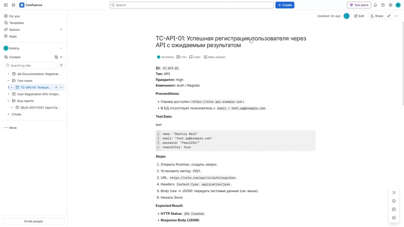
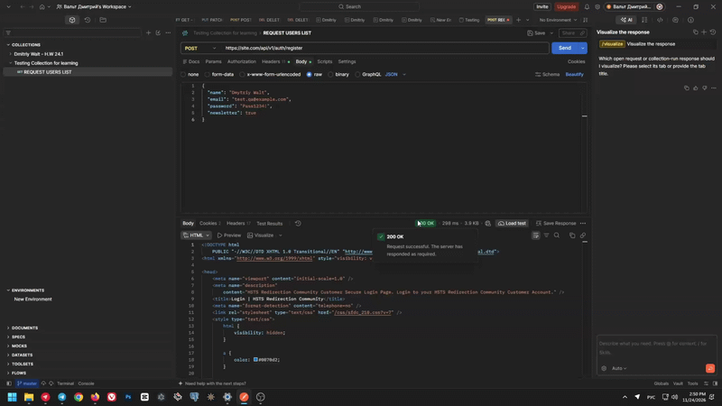
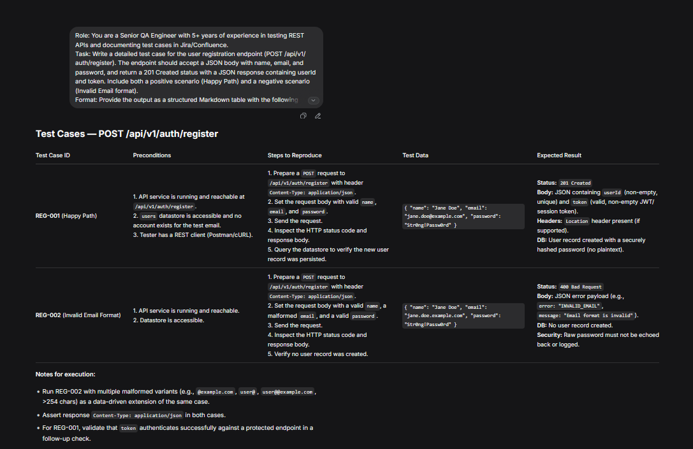

# Case Study: Personal QA Practice & Documentation (Confluence)

**Project:** Personal QA Practice (Self-Study + AI Assistance)
**Date Started:** November 2026
**Tools Used:** Confluence, Postman, Jira (simulation), ChatGPT / Gemini (AI Assistance).

---

## 📝 Project Context & Overview
This is my personal initiative to simulate a real QA workflow in a team environment. Since I don't have a commercial project yet, I created my own QA documentation space in Confluence. I used YouTube tutorials and AI assistants to understand how to structure test plans, write test cases, and report bugs properly.

## 🛠 My Approach & Deliverables

I created a structured workspace in Confluence that mimics a real QA project. The main goal was to practice **Traceability** — linking requirements to test cases and then to bug reports.

### 1. AI Prompt Engineering (RTF Formula)
To get high-quality results from AI, I didn't just ask generic questions. I used the **RTF (Role, Task, Format)** formula to structure my prompts:

*   **Role:** "You are a Senior QA Engineer."
*   **Task:** "Create a test case for the user registration API."
*   **Format:** "Provide the output as a table with ID, Steps, Test Data, and Expected Result."

This structured approach helped me generate professional templates for Test Cases and Bug Reports. I then manually reviewed and adapted them for my specific Confluence page.

### 2. Documentation Structure
I organized my Confluence space into the following sections:
*   **Requirements:** Documented the feature (e.g., API user registration).
*   **Test Cases:** Created detailed test cases with steps, test data, and expected results.
*   **Bug Reports:** Documented defects found during testing, using Jira-like formatting (Severity, Priority, Environment, Steps to Reproduce).

### 3. The Practice Flow (Traceability)
1.  **Analyzed the requirements** for a user registration API.
2.  **Wrote a Test Case** (TC-API-01) with steps for a positive scenario (Happy Path).
3.  **Executed the test** in Postman. I discovered that the server returned `200 OK` and an HTML page instead of the expected `201 Created` and JSON.
4.  **Logged a Bug Report** (BUG-001) detailing the issue, attaching Postman screenshots as evidence.
5.  **Linked them together** in Confluence to ensure traceability.

   
### 🤖 4. AI Prompt Engineering (RTF Formula)
To ensure high-quality documentation, I didn't just ask the AI to "write a test case". I used the **RTF (Role, Task, Format)** formula to structure my prompt and get a professional result.

**My Prompt Example (RTF):**
> **Role:** You are a Senior QA Engineer with 5 years of experience in API testing.
> **Task:** Write a detailed test case for the `POST /api/v1/auth/register` endpoint. The endpoint should return 201 Created and JSON. 
> **Format:** Provide the output in a table with columns: `Test Case ID`, `Preconditions`, `Steps`, `Test Data`, `Expected Result`. Add a negative scenario (invalid email).

**Why this matters:** Using RTF helped me get a structured, ready-to-use response on the first try, saving time and ensuring the documentation met industry standards.

## 📸 Proof of Work

*(Screenshots of my Confluence workspace)*

**1. Test Case (TC-API-01):**

**2. Bug Report (BUG-001):**

**AI Prompt Engineering (RTF) Proof:**

## 💡 Conclusion
This personal practice project helped me bridge the gap between theoretical knowledge and real-world QA workflows. I learned how to use Confluence as a tool for ensuring traceability and communication. Moreover, mastering the **RTF formula for AI prompts** allowed me to speed up my documentation process while maintaining high quality.
