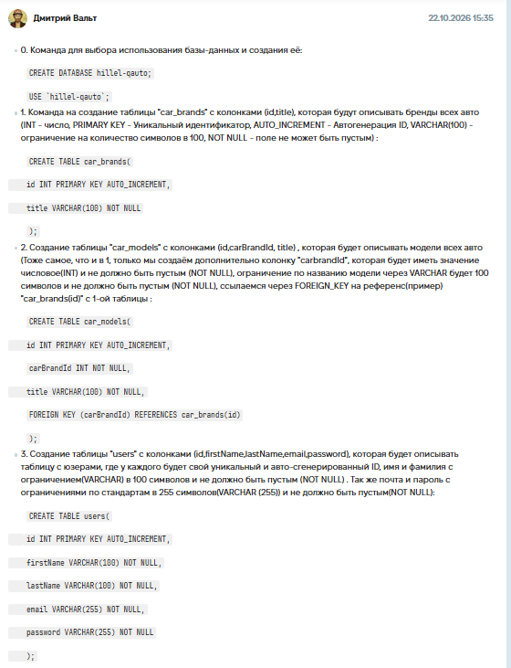
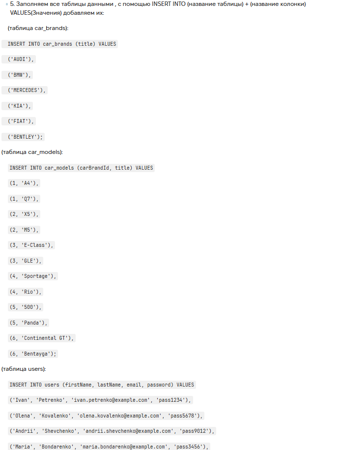

# Case Study: Database Design & Data Definition Language (DDL)

**Project:** "qaAuto" Car Management Database (Educational Project)

**Task:** Design and create a relational database schema from scratch. Create four tables (`car_brands`, `car_models`, `users`, `cars`), establish relationships using Foreign Keys, apply constraints (Primary Keys, NOT NULL, UNIQUE, DEFAULT), and populate the tables with test data.

**Tools Used:** MySQL / SQL (DDL & DML) / MySQL Workbench.

**Date Completed:** 22.10.2026

---

## 📝 Project Context & Overview
This assignment focused on the foundational aspect of working with databases: designing the schema. The goal was to create a relational structure for a car management system, establish correct relationships between tables to maintain referential integrity, and fill the tables with initial data. A key requirement was to ensure data validity using constraints like `NOT NULL` and `UNIQUE`.

## 🛠 My Approach & Deliverables

I approached this by first planning the Entity-Relationship (ER) model to ensure proper connections via Foreign Keys. Then, I wrote the SQL scripts to create the database, tables, and populate the data. The entire workflow was divided into two main stages: creating the structure (DDL) and filling it with data (DML).

## 🏗️ 1. Database & Table Creation (DDL)
I started by creating the database and setting it as active. Then, I built the tables sequentially to satisfy Foreign Key dependencies (brands -> models -> users -> cars).

**Key technical implementations:**
*   **Primary Keys:** Used `INT PRIMARY KEY AUTO_INCREMENT` for all tables to ensure each record has a unique identifier.
*   **Foreign Keys:** Linked `car_models` to `car_brands`, and `cars` to `users`, `car_brands`, and `car_models`. This ensures referential integrity (e.g., you cannot create a car for a non-existent user).
*   **Constraints:** Applied `NOT NULL` for essential fields, `UNIQUE` for the `email` column in the `users` table (to prevent duplicate registrations), and `DEFAULT 0` for mileage columns in the `cars` table.

## 📥 2. Data Population (DML)
After creating the structure, I populated the tables using `INSERT INTO`. The data was added in a specific order (brands -> models -> users -> cars) to satisfy the Foreign Key constraints.

**Example of Data Insertion:**

INSERT INTO car_brands (title) VALUES ('AUDI'), ('BMW'), ('MERCEDES');
INSERT INTO users (firstName, lastName, email, password) VALUES 
('Ivan', 'Petrenko', 'ivan.petrenko@example.com', 'pass1234');

**🐞 Examples of Implemented Constraints (from Schema)**
1. Data Integrity (UNIQUE)

Column: email in users table.

Purpose: Prevents two users from registering with the same email address. Ensures data quality at the database level.

2. Referential Integrity (FOREIGN KEY)

Column: carBrandId in car_models table.

Purpose: Ensures that a car model cannot be created without linking it to an existing brand in car_brands.

3. Default Values (DEFAULT 0)

Columns: mileage, initialMilleage in cars table.

Purpose: Automatically assigns a starting value of 0 if no mileage is provided during car creation.

**📸 Proof of Work**
(Screenshots of the successfully executed SQL scripts and the resulting tables)

**Database Schema Creation:**

**Data Population:**

**💡 Conclusion**
This task allowed me to practice database design from scratch. I learned the importance of defining proper data types, applying constraints like NOT NULL and UNIQUE, and setting up FOREIGN KEY relationships to maintain referential integrity. I also reinforced my understanding of the correct order of operations when inserting related data, which is crucial for avoiding errors in a real production environment.

*(Screenshot of the completed assignment and feedback)*

