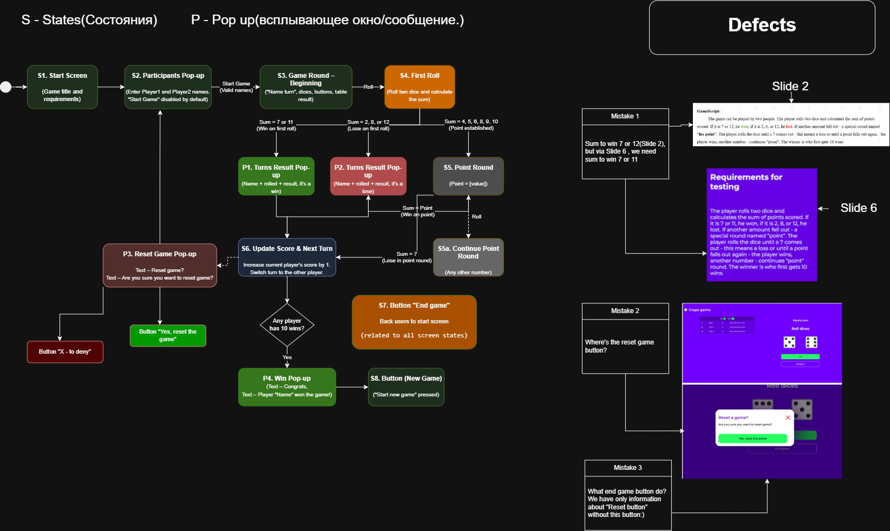

# Case Study: State Transition Diagram for a Game Application

**Project:** "Craps Game" Web Application (Educational Project)
**Task:** Create a State Transition Diagram based on the provided requirements and identify logical conflicts.
**Tools Used:** Diagrams.net (draw.io) / Google Docs.

---

## 📝 Project Context & Overview
The goal was to model the game logic and visualize how the application transitions from one state to another based on user actions and dice rolls.

**Key Game Rules (from requirements):**
*   **Start:** Two players enter their names.
*   **First Roll:** Player rolls two dice.
*   **Win Condition:** 7 or 11 points.
*   **Lose Condition:** 2, 3, or 12 points.
*   **Point Round:** If another number is rolled, it becomes the "point". The player rolls until they hit the point again (Win) or roll a 7 (Lose).
*   **Game Winner:** First to reach 10 wins.

## 🗺 State Transition Diagram
*(Here is the visual representation of the game logic)*

## 🐞 Critical Defect Found in Requirements
During the analysis, I identified a critical **inconsistency in the specification**. 
The GameScript (Slide 2) states that rolling a sum of **12** is a winning result ("If it is 7 or 12, he won"). However, the next sentence in the same script states that 12 is a losing result ("if it is 2, 8, or 12, he lost"). 

**Resolution:** This logical conflict must be clarified with the Product Owner before development begins. It is impossible to build an accurate transition for the number 12 without this clarification.

## 🛠 Additional UX/UI Findings
While reviewing the mockups and requirements, I noted the following gaps:
*   **Button "End game":** The UI shows this button, but the requirements do not describe what happens when it is clicked (does it save progress, reset, or just close?).
*   **Reset Game button:** The mockups show a "Reset Game" pop-up, but the requirements text does not mention where the "Reset" button itself is located on the main screen.

## 💡 Conclusion
Creating the State Transition Diagram helped visualize the game flow, but more importantly, it highlighted a fatal flaw in the requirements (the conflicting rules for number 12). Catching this during the static testing phase saved the development team from creating a buggy game logic.
