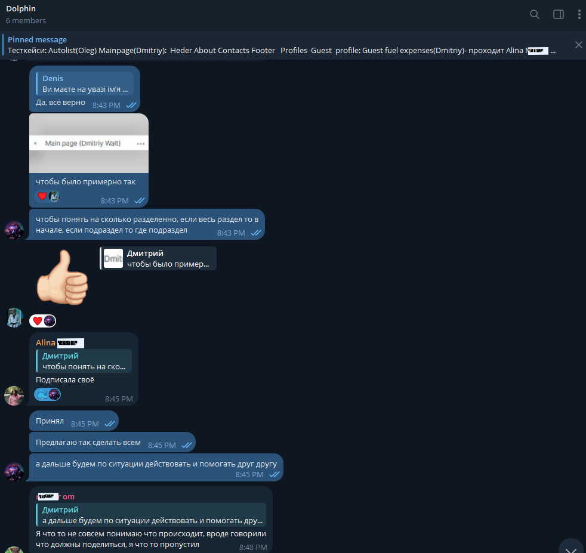
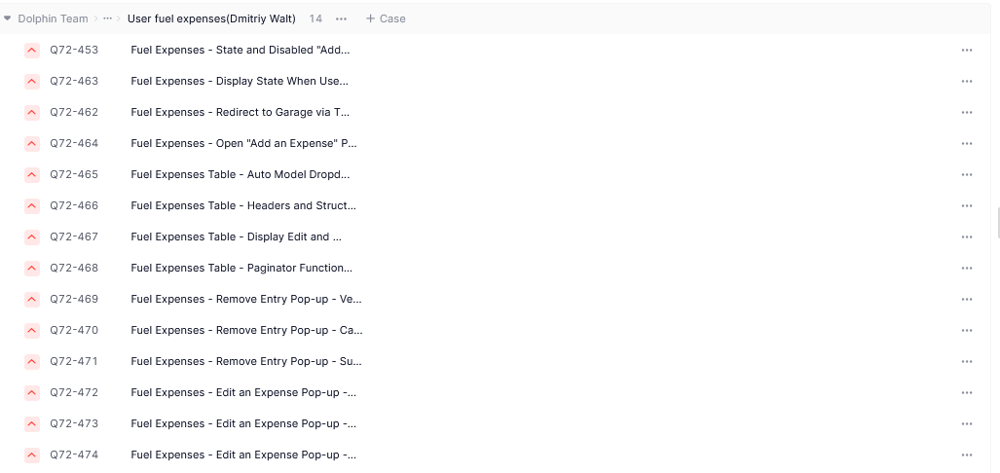
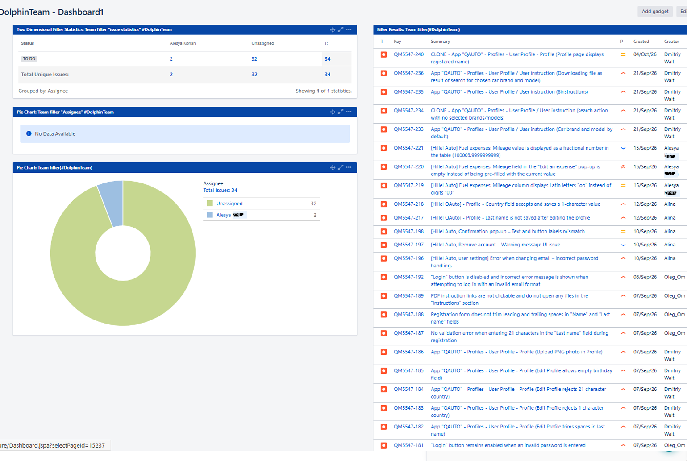
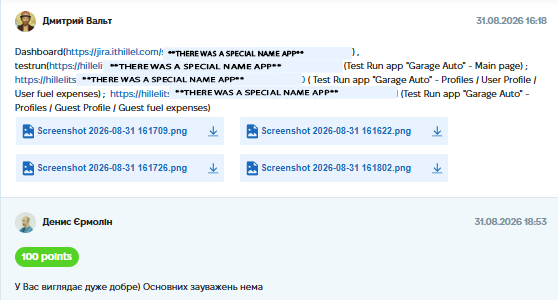

# Case Study: Teamwork, Test Planning & Execution

**Project:** Automotive Service Web Application (Educational Sandbox)
**Task:** Simulate a real QA team workflow: distribute roles, write test cases for specific blocks, execute a Test Run, and create a team dashboard in Jira.
**Tools Used:** TestLaba, Jira, Telegram (for communication).
**Date Completed:** 31.08.2026 16:18

---

## 📝 Project Context & Overview
In this team assignment, our group acted as a QA squad for an automotive service web application. The goal was to organize communication, divide the application into logical blocks, write test cases, and execute a full Test Run.

## 🛠 My Role & Approach

### 1. Team Organization & Communication
*   We set up a communication channel in Discord to sync our actions and share credentials.
*   We divided the application into logical blocks (Header, Main Page, Login, Registration, Guest Profiles, Fuel Expenses).

### 2. My Specific Responsibilities
While working in the team, I took the lead on several key aspects:
*   **Test Case Design & Execution:** I was responsible for testing three main blocks of the application. I wrote test cases and executed full Test Runs for:
    *   **Main Page** (Header, Main Banner, Navigation).
    *   **Profiles: User Profile** (User details, Fuel Expenses table, Add/Edit Expense popups).
    *   **Profiles: Guest Profile** (Guest details, Fuel Expenses table, validation rules).
*   **Creating the Team Dashboard:** I was responsible for building the visual Jira Dashboard to track our team's progress (creating filters for assignees and setting up Pie Charts to visualize the workload distribution).

*(Screenshot of my team communication and coordination)*

### 3. Deliverables

**A. Test Execution Example (TestLaba)**
Here is an example of one of the Test Runs I executed. This specific run covers all "Main Page" functionality and visuality. It clearly demonstrates my ability to mark steps as Passed/Failed and identify real defects (e.g., validation issues with empty fields or incorrect password formats).

*(Screenshot of the Test Run execution in TestLaba)*

**B. Jira Team Dashboard**
A working dashboard showing the status of tasks for all team members (To Do, In Progress, Done).

*(Screenshot of the Jira Dashboard I created for the team)*

## 💡 Conclusion
This teamwork project was highly valuable. It showed me that testing is not just about finding bugs, but also about **communication, task distribution, and maintaining visibility** of the testing process for the whole team.

## 📸 Proof of Work
*(Screenshot of the completed assignment and feedback)*

