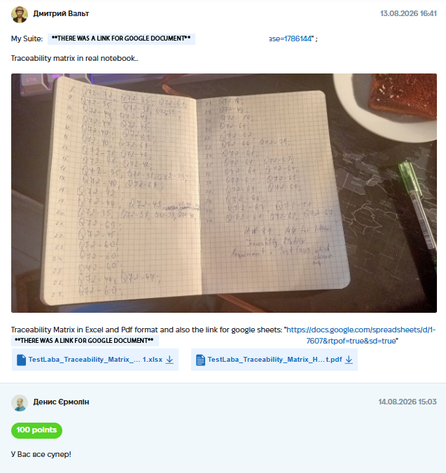

# Case Study: Test Case Design & Requirements Traceability Matrix

**Project:** "Help for Kittens" Web Application (Educational Project)
**Date Completed:** August 2026
**Task:** Create comprehensive test cases based on requirements and build a Requirements Traceability Matrix (RTM) to ensure 100% test coverage.
**Tools Used:** TestLaba (Test Management System) / Google Sheets.
**Date Completed:** 13.08.2026 16:41

---

## 📝 Project Context & Overview
The goal was to design a full test suite for the "Help for Kittens" app (a platform for virtual cards and donations). 
To ensure high quality, I needed to cover all user flows, including:
*   **Account Tab:** Virtual card creation, validation of First/Last names (2-20 English chars), and card replenishment.
*   **Donate Tab:** Processing payments with strict validation (Card number length, CVV format, Expiry date, max amount).
*   **UI/UX:** Checking disabled states of buttons (e.g., "Create a virtual card" is disabled until valid data is entered).

## 🛠 My Approach & Deliverables

### 1. Test Case Creation (TestLaba)
I designed **27 detailed test cases** covering positive, negative, and edge-case scenarios for the application.
*   Each test case included Preconditions, Steps, Expected Results, and Priority.
*   Example of validation covered: Checking that the "Add moneys" button remains disabled if the amount is 0 or negative.

### 2. Requirements Traceability Matrix (RTM)
To ensure no requirement was left untested, I built a **Traceability Matrix** in Google Sheets. 
*   I mapped every Requirement ID (from the specification) to specific Test Case IDs.
*   **Coverage Goal:** Ensure every requirement has at least one test case mapped to it. This helps identify "dead" test cases (which don't test any requirement) and "gaps" (requirements without tests).

*(Visual representation of the Traceability Matrix)*

## 💡 Conclusion
Creating a traceability matrix before execution helped visualize test coverage. It proved that all critical business flows (card generation, donation validation) were covered by test cases, reducing the risk of missing critical bugs during regression.

## 📸 Proof of Work
*(Screenshot of the completed assignment and feedback)*

