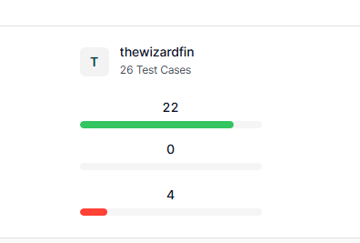
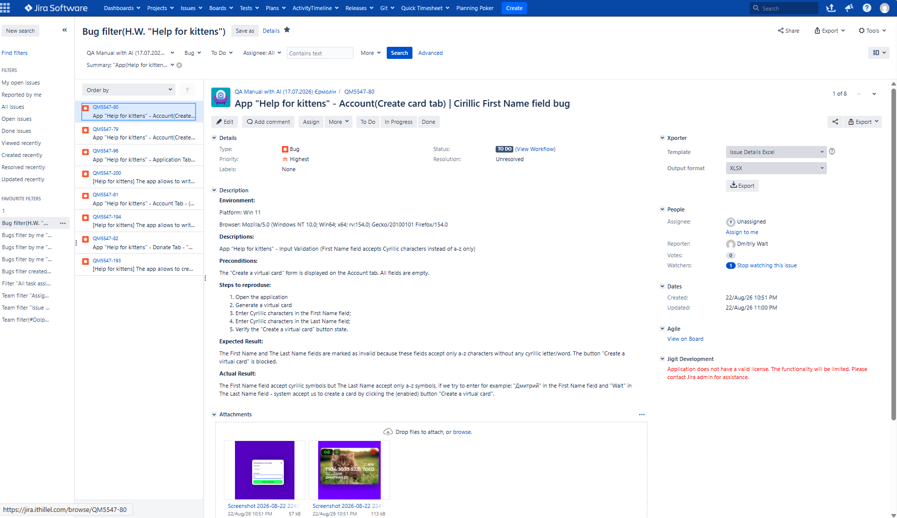
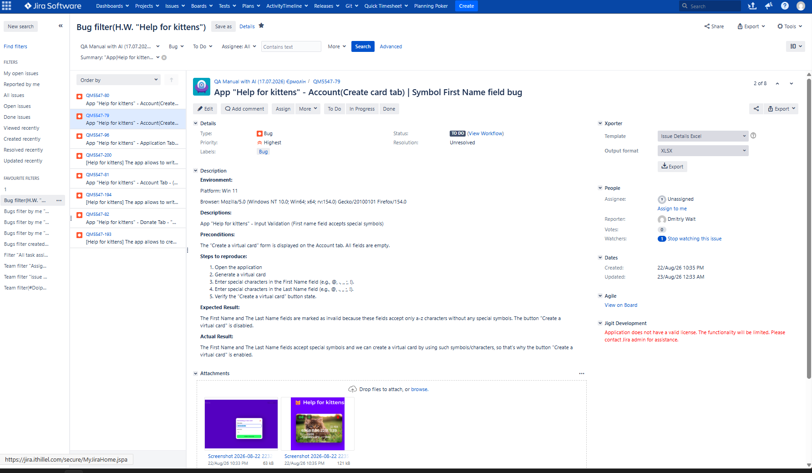
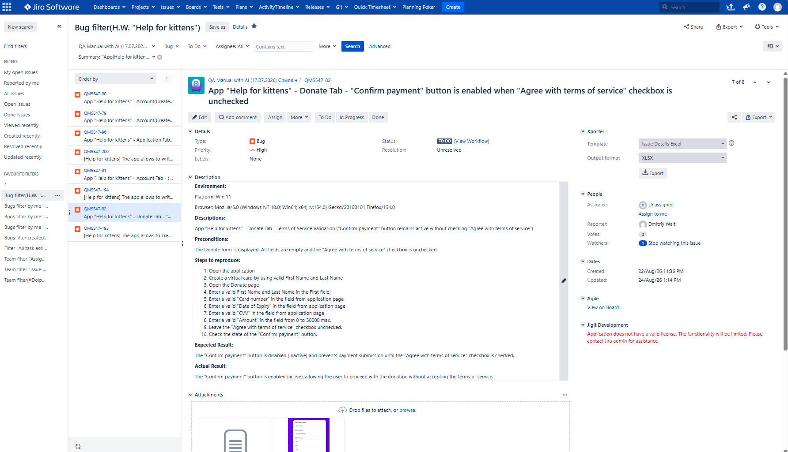
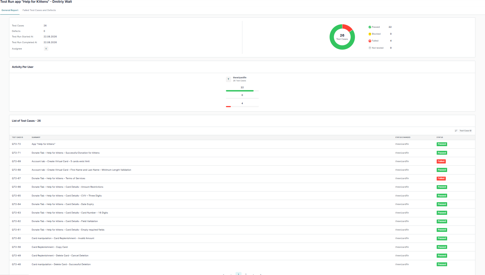
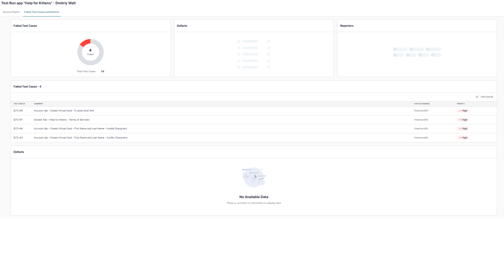
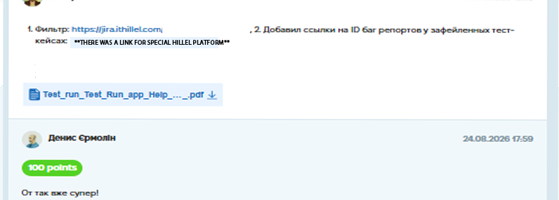

# Case Study: Test Execution & Bug Reporting (Help for Kittens)

**Project:** "Help for Kittens" Web Application (Educational Project)
**Task:** Execute a Test Run based on created Test Cases, document defects, and create visual Test Reports.
**Tools Used:** TestLaba (Test Management) / Jira (Bug Tracking).
**Date Completed:** 23.08.2026 01:04 - 24.08.2026 13:10

---

## 📝 Project Context & Overview
The goal of this assignment was to perform the actual testing phase (Test Execution). I needed to run a suite of test cases, identify defects, log them in Jira, and generate a final Test Report summarizing the quality of the application.

## 🛠 My Approach & Deliverables

### 1. Test Execution (TestLaba)
I executed a suite of **26 test cases** covering the "Account" (card creation) and "Donate" (payment processing) tabs. 
*   **Passed:** 22
*   **Failed:** 4
*   **Blocked/Skipped:** 0

*(Screenshot of the Test Run report showing 22 Passed and 4 Failed)*

### 2. Bug Reporting (Jira)
For the 4 failed test cases, I created detailed bug reports in Jira. Here are examples of critical defects found:

**🐞 Bug 1: Input Validation Bypass (Cyrillic Characters)**
*   **Jira ID:** QM5547-80
*   **Issue:** The First Name field accepts Cyrillic characters (e.g., "Дмитрий") and allows the user to create a card, despite the requirement strictly stating "only English chars".
*   **Priority:** Highest

**🐞 Bug 2: Input Validation Bypass (Special Symbols)**
*   **Jira ID:** QM5547-79
*   **Issue:** The First Name field accepts special symbols (e.g., @, #, $, %), which should be blocked by validation.
*   **Priority:** Highest

**🐞 Bug 3: Terms of Service Logic Flaw**
*   **Jira ID:** QM5547-82
*   **Issue:** On the Donate tab, the "Confirm payment" button becomes active and allows a donation even if the "Agree with terms of service" checkbox is unchecked.
*   **Priority:** High

*(Screenshot of Jira Bug Report QM5547-80)*

*(Screenshot of Jira Bug Report QM5547-79)*

*(Screenshot of Jira Bug Report QM5547-82)*

### 3. Final Test Report
After the execution, I generated a final report in TestLaba. It provides a visual dashboard of the testing progress, clearly showing that 4 critical defects were found and need to be fixed before the release.

*(Screenshot of the Test Run summary dashboard passed and failed)*

*(Screenshot of the Test Run summary dashboard failed)*

## 💡 Conclusion
This task demonstrated the complete QA cycle: planning -> execution -> reporting. It proved that even in a simple application, strict validation (especially for Cyrillic and special symbols) is often missed by developers and must be caught by QA.

## 📸 Proof of Work
*(Screenshot of the completed assignment and feedback)*

