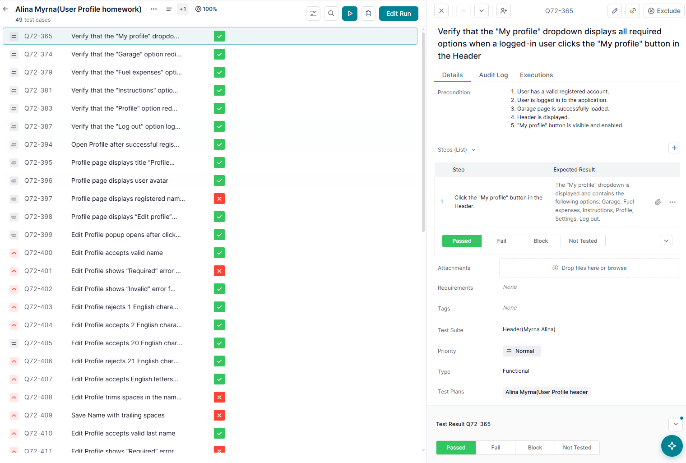
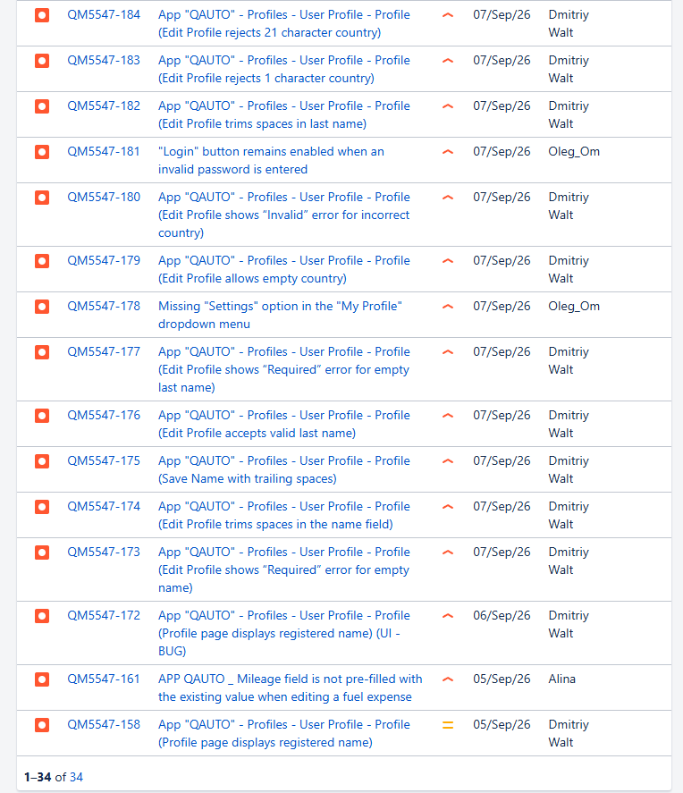
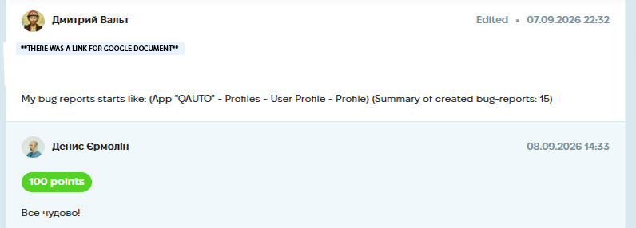

# Case Study: Full Test Execution & Bug Reporting (qaAuto)

**Project:** "qaAuto" Web Application (Educational Project)
**Task:** Execute the planned test cases, identify defects, and log formal Bug Reports in Jira.
**Tools Used:** TestLaba (Test Management), Jira (Bug Tracking), Google Docs.
**Date Completed:** 07.09.2026 22:32

---

## 📝 Project Context & Overview
After creating the Test Plan, the next phase was the actual execution. The goal was to run the prepared test cases, verify the functionality of the User Profile and Header sections, and document any deviations from the requirements.

## 🛠 My Approach & Deliverables

### 1. Test Execution (TestLaba)
I executed a test run covering **49 test cases** (focusing on the User Profile, Header dropdowns, and Edit Profile validations). 
*   I marked passed tests as **PASSED** and failures as **FAILED**.
*   Example of a passed case: Verifying that the "My Profile" dropdown displays all required options (Garage, Fuel expenses, Instructions, Profile, Settings, Log out).

*(Screenshot of the Test Run execution in TestLaba)*

### 2. Bug Reporting (Jira)
During execution, I identified multiple defects and logged them in Jira (15 bug reports in total). Below are examples of critical issues found during validation testing:

*   **QM5547-184:** Edit Profile rejects 21 character country (Boundary Value validation issue).
*   **QM5547-183:** Edit Profile rejects 1 character country (Boundary Value validation issue).
*   **QM5547-181:** "Login" button remains enabled when an invalid password is entered (UI/Logic issue found by a teammate).
*   **QM5547-177:** Edit Profile shows "Required" error for empty last name (Missing validation).
*   **QM5547-174:** Edit Profile trims spaces in the name field (Data handling bug).

*(Screenshot of the Jira Bug List)*

## 📸 Proof of Work
*(Screenshot of the completed assignment and feedback)*

## 💡 Conclusion
This task was the culmination of the QA cycle: planning -> execution -> reporting. It proved my ability to systematically run tests, catch boundary value errors (like character limits), and document them clearly for developers to fix.
