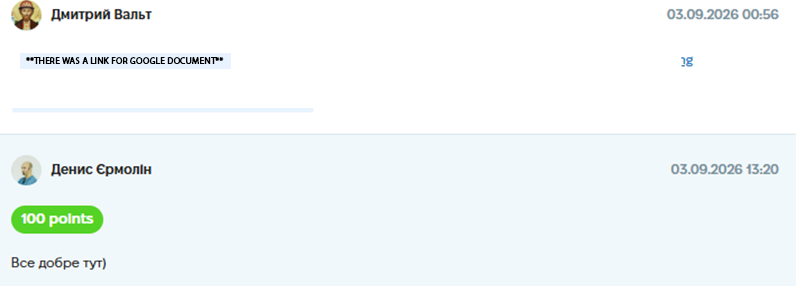
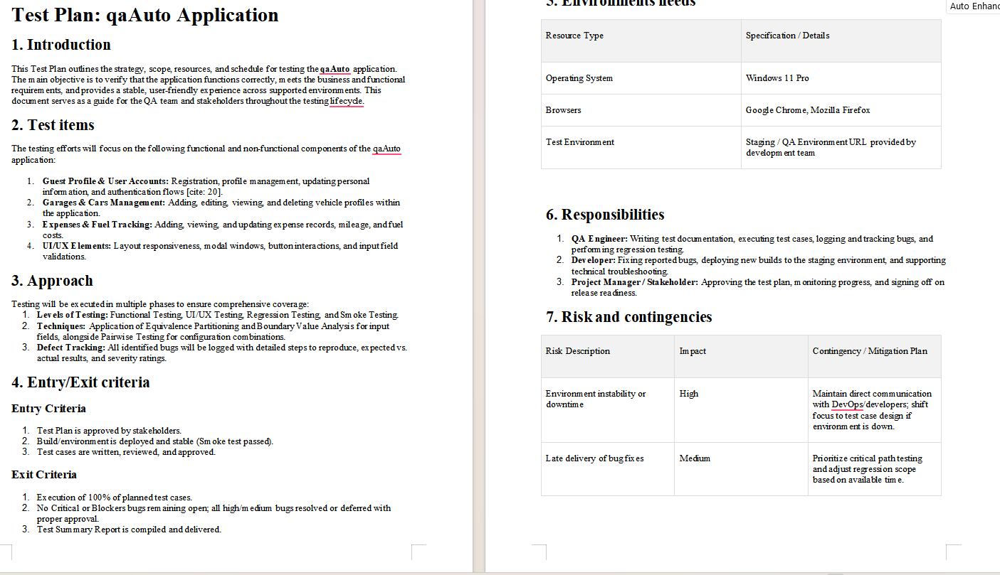

# Case Study: Test Plan Creation for a Web Application

**Project:** "qaAuto" Web Application (Educational Project)
**Task:** Create a comprehensive Test Plan outlining the strategy, scope, resources, and schedule for testing the application.
**Tools Used:** Microsoft Word / Google Docs.
**Date Completed:** 03.09.2026 00:56

---

## 📝 Project Context & Overview
The goal was to define the testing strategy for the "qaAuto" application (a platform for managing cars, fuel expenses, and user profiles). A well-structured Test Plan is crucial for aligning the QA team with stakeholders and ensuring all critical business flows are covered.

## 🛠 My Approach & Deliverables

I created a formal Test Plan covering all standard IEEE 829 sections:

### 1. Introduction & Test Items
*   Defined the main objective: verifying functional and non-functional requirements.
*   Identified key test items: Guest/User profiles, Garage/Car management, Fuel Expenses tracking, and UI/UX elements (modals, inputs, responsiveness).

### 2. Approach & Techniques
*   **Levels of Testing:** Functional, UI/UX, Regression, and Smoke testing.
*   **Techniques:** Applied Equivalence Partitioning, Boundary Value Analysis, and Pairwise Testing for complex inputs.
*   **Defect Tracking:** Standardized bug reporting with steps to reproduce and severity ratings.

### 3. Entry/Exit Criteria
*   **Entry:** Test Plan approved, environment is stable (Smoke passed), and test cases are reviewed.
*   **Exit:** 100% of planned test cases executed, no Critical/Blocker bugs open, and a Test Summary Report is delivered.

### 4. Environment Needs
*   **OS:** Windows 11 Pro.
*   **Browsers:** Google Chrome, Mozilla Firefox.
*   **Environment:** Staging/QA environment provided by the dev team.

### 5. Responsibilities
*   **QA Engineer:** Writing documentation, executing tests, logging bugs, and regression.
*   **Developer:** Fixing bugs and deploying new builds.
*   **Project Manager:** Approving the plan and signing off on release readiness.

### 6. Risks & Contingencies
*   **Risk 1 (High):** Environment instability/downtime. 
    *   *Mitigation:* Maintain communication with DevOps, switch to test case design if the environment is down.
*   **Risk 2 (Medium):** Late delivery of bug fixes.
    *   *Mitigation:* Prioritize critical path testing and adjust regression scope based on available time.

## 📸 Proof of Work
*(Screenshot of the completed assignment and feedback)*

*(Excerpt from the Test Plan document)*

## 💡 Conclusion
Writing this Test Plan helped me understand the importance of **planning and risk management** in QA. It showed me that a good QA engineer doesn't just find bugs, but also defines *how* and *when* testing will be performed, and what to do if the environment fails.
